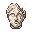
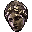
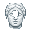

# 通货与备用贴图对照

这份对照表记录已经应用到游戏通货的贴图。图中部分形象相似或重复，参考图没有标注名称；“流放之路对应物”按功能比较，不代表已经确认该贴图就是对应通货的官方图标。

贴图编号中，`1-2-3` 表示第 1 张参考图、第 2 行、第 3 列。图像放大显示，实际文件均为 32×32 像素；图案按参考图原始像素拆分并居中。

| 贴图 | 本地通货 | 流放之路中最接近的通货 | 功能与差异 |
|---|---|---|---|
|  1-1-1 | 蜕变石 | 蜕变石（Orb of Transmutation） | 都将普通装备提升品质并增加词条；两边品质体系不同。 |
|  1-2-1 | 增幅石 | 增幅石（Orb of Augmentation） | 都增加词条；本地还会提升装备品质。 |
|  2-1-3 | 富豪石 | 富豪石（Regal Orb） | 都提升品质并增加一条词条；品质名称和层级不同。 |
|  1-4-1 | 崇高石 | 崇高石（Exalted Orb） | 都给符合条件的高品质装备增加随机词条。 |
|  1-1-2 | 剥离石 | 剥离石（Orb of Annulment） | 都随机移除一条词条；本地只选择符合条件且未锁定的词条。 |
|  2-2-2 | 混沌石 | 混沌石（Chaos Orb） | 本地替换一条词条，更接近《流放之路 2》；初代通常重铸稀有装备的随机词条。 |
|  2-1-1 | 神圣石 | 神圣石（Divine Orb） | 都重新随机词条数值而保留词条种类；适用范围与数值规则不同。 |
|  1-4-1 | 高级神圣石 | 神圣石（Divine Orb） | 本地神圣石的高保底版本，没有确认到严格对应的普通神圣石。 |
|  3-3-3 | 完美神圣石 | 神圣石（Divine Orb） | 本地更高保底版本，并不保证所有词条达到最大值。 |
|  3-2-4 | 破溃宝珠 | 破裂石（Fracturing Orb） | 都随机固定一条词条，具体资格及限制不同。 |
|  1-2-3 | 瓦尔宝珠（原狄瑞吉之血） | 瓦尔宝珠（Vaal Orb） | 都使装备腐化并产生随机结果；本地涉及等级、洗值和孔位的独立随机变化。 |
|  3-1-4 | 打孔石 | 工匠石（Artificer's Orb）或初代珠宝匠石 | 都涉及孔位；本地直接增加一个孔，不等同于随机重掷孔数。 |
|  1-3-1 | 升级石 | 无严格对应 | 本地将普通至传说装备提升 5 级，最高 80 级。 |
|  3-3-3 | 史诗升级石 | 无严格对应 | 本地史诗装备提升 5 级，最高 80 级。 |
|  2-4-2 | 神话升级石 | 无严格对应 | 本地神话装备提升 5 级，最高 80 级。 |
|  3-2-2 | 套装拆解石 | 无严格对应 | 消耗有套装的装备，提取套装石。 |
|  1-4-2 | 套装石 | 无严格对应 | 把记录的套装赋予符合等级和部位要求的装备。 |
|  3-4-2 | 词条拆解石 | 无严格对应 | 消耗装备并提取词条宝石，与单纯删除词条不同。 |
|  2-4-3 | 词条宝石 | 无严格对应 | 携带提取出的词条并镶嵌到装备上；概念上接近可镶嵌物，但效果体系不同。 |

本地还有 37 种工艺精华和 51 种固定宝石，以及金币、点券、无色小晶块等账户通货；这些没有在此表中强行分配面孔贴图。未用于本表的贴图暂作备用。

## 参考来源

- 本地登记：[CurrencyRules.java](../src/main/java/cn/yumis/fight/modules/economy/api/CurrencyRules.java)、[EquipmentRules.java](../src/main/java/cn/yumis/fight/modules/equipment/api/EquipmentRules.java)、[EquipmentChanges.java](../src/main/java/cn/yumis/fight/modules/equipment/api/EquipmentChanges.java)。
- 流放之路：[官网物品说明](https://www.pathofexile.com/item-data)、[官网论坛制作资源指南](https://webcdn.pathofexile.com/forum/view-thread/54003)（历史资料）、[PoE Wiki 通货目录](https://www.poewiki.net/wiki/Currency)。官网物品图标接口本次未能读取，因此没有将表中图像标为已核实的官方原图。
