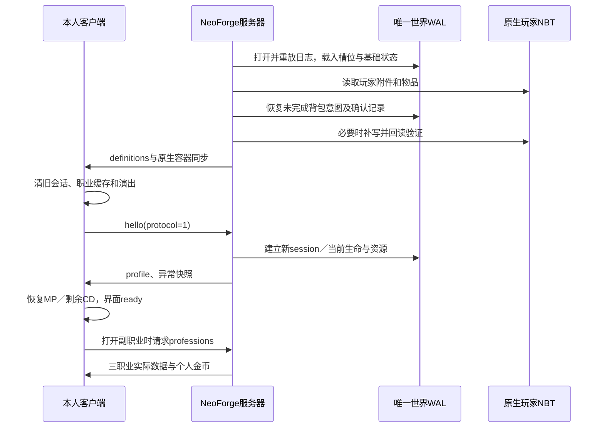
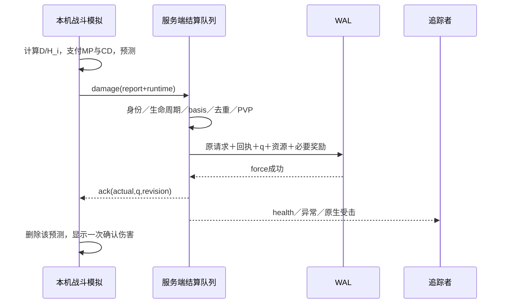

# YumisDungeonAndFight：完整功能、双端通信与新工程重建规格

整理日期：2026-10-26。用途：在新的位置重新制作独立 NeoForge 项目时，作为功能、数据、资源和验收依据。本文整理了现有 YDNF、YumisCore 工作区以及本次对话已经确认的新要求；不要求新工程沿用现有 Java 类的组织方式。

**最新目标：Minecraft 26.2、NeoForge 26.2.0.93、Java 25，一个名为 `YumisDungeonAndFight`、ID 为 `yumis_dungeon_and_fight` 的双端模组。Core 功能打进同一个 JAR，不安装独立 Core，不包含空岛玩法或空岛兼容。**

**当前迁移工程尚未完成客户端验收。**现有证据为 48 项单元测试、6 项无 GUI GameTest，以及普通隔离专用服启动；两个真实客户端均在背包界面 Mixin 应用阶段失败，未形成真实双人功能通过记录。详见第 19 章。文档中的目标规则、源码现状与测试结果应分别理解。

## 0. 阅读与搬运

### 0.1 本交接包的内容

| 文件或目录 | 用途 |
|---|---|
| 本文 | 完整玩法、界面、服务职责、协议、持久化、重建顺序和验收标准 |
| [图片与资源索引](图片与资源索引.md) | 所有现存游戏 PNG、对应模型、123 款装备名称和图片逐项引用 |
| [resources/](resources/) | 当前可确认的完整运行资源快照，共 348 个文件；包括 167 张游戏 PNG |
| [art/menu/](art/menu/) | 本次新增的七份 Aseprite 源稿、绘制回执与像素核对记录 |
| [images/historical-fabric/](images/historical-fabric/) | 旧工程现存七张界面截图；仅供了解旧外观 |
| [asset-manifest.json](asset-manifest.json) | 资源包内路径、原始绝对路径、字节数、图片尺寸和 SHA-256 |
| [model-reference-map.json](model-reference-map.json) | JSON 中模型、父模型及纹理引用关系，含原版引用 |
| [source-map.csv](source-map.csv) | 本次读取的迁移工程 Java 文件位置及 SHA-256；不包含源码正文 |
| [verification/](verification/) | 本次能定位的构建、测试、专服和失败客户端日志副本 |
| [tools/create_menu_icons.py](tools/create_menu_icons.py) | 已使用的 Aseprite MCP 原生绘图脚本；换机器须调整本地路径 |

把整个 `rebuild` 目录带到新位置，保留层级，文档里的图片和文件引用即可继续使用。新建工程后，将 `resources/` 的**内部内容**放到新工程的 `src/main/resources/`；将 `art/menu/` 作为版本管理内的美术源稿保留。本包是文档与素材交接包，不是完整可构建源码备份，也不带正式世界。

### 0.2 规则与状态标记

| 标记 | 含义 |
|---|---|
| 已确认目标 | 用户已确认，新工程必须保留的行为；最新对话优先 |
| 当前源码 | 实际读取到的实现；可以借鉴，不能直接当作已运行通过 |
| 首轮参数 | 现有公式、模板和数值基线；手感、时长和平衡仍由用户游玩测试 |
| 待验收 | 已有实现或方案，但 NeoForge 对应运行证据尚不足 |
| 延期／排除 | 本轮不新增的内容，不能因旧代码或旧文档存在而自动扩入 |

本文记录的是 2026-10-26 工作区快照，包含尚未提交的整合内容。旧 Fabric JAR、旧文档的完成勾选以及旧截图均不能替代新 NeoForge 验证。

### 0.3 当前文件来源与命名

| 内容 | 本机位置／身份 |
|---|---|
| 原战斗工程 | `C:\GameApp\YDNF`；旧 ID `yumis_dunguen_and_fight`，旧名称保留了 `Dunguen` 拼写 |
| 原基础服务工程 | `C:\GameApp\YumisCore`；原先独立模组，现目标为内部模块 |
| 当前未完成的 NeoForge 迁移工程 | `C:\GameApp\YumisDungeonAndFight` |
| 本次新身份 | `YumisDungeonAndFight`／`yumis_dungeon_and_fight`；使用正确 `Dungeon` 拼写 |
| 用户给定的游戏实例 | `C:\Users\63569\Desktop\pcl\.minecraft\versions\26.2-NeoForge_26.2.0.93` |
| 目标安装目录 | 上述实例的 `mods`；截至本记录尚未安装新开发 JAR |

用户准备在新位置重建，新的源码根目录可自行选择。不要把本文中的 `C:\GameApp\...` 写死为游戏运行条件。新模组注册、资源、网络、数据包、附件与持久化路径统一新身份；Java 包名可暂保留 `cn.yumis.ydnf`、`cn.yumis.core`，这不代表运行时仍安装两个模组。

## 1. 本次对话新增与取代旧规则的决定

| 主题 | 本次最终要求 | 被取代的历史行为 |
|---|---|---|
| 平台 | NeoForge 26.2.0.93、Minecraft 26.2、Java 25 | 原 Fabric 接入方式 |
| 安装 | 客户端、服务器安装同一个单模组 JAR，内置 Core | 独立安装 YDNF＋Core |
| 空岛 | 不制作玩法、兼容、依赖检测、界面或按键迁移 | 可选 Sky 桥接、岛屿资产及岛币 |
| 存档 | 仅面向新存档；保留原工程与正式存档 | 旧 Fabric 世界全量转换 |
| 默认入口 | `I` 打开紧凑图标菜单 | `U` 跨功能 Tab、Core 的 `P` 入口 |
| 页面组织 | 七个独立功能页面，功能页返回菜单 | 在同一页面切不同功能 Tab |
| 关闭 | 任意模组页面或详情层按 Esc，一次关闭全部模组 UI | Esc 逐层退回 |
| 菜单布局 | 每行四格，随入口数增行；超高纵向滚动；空格无功能 | 任意列数或空白可点占位 |
| 菜单标签 | 功能名始终在图标上方，原版默认字号 | 只悬停显示名称／缩小文字 |
| 新图标 | Aseprite MCP 原生绘制七张 32×32、透明、四层可编辑图 | 只交付扁平 PNG 或缩小参考图 |
| 装备入口 | 通过 `E` 生存／创造背包右侧扩展栏管理 | 新增独立“装备”菜单入口 |
| 设置 | 面板大小、伤害数字倍率、目标框位置与倍率集中 | 参数散在属性／地下城页面 |
| 三副职业 | 只保留模型、真实状态同步与查看页 | 搬入空岛采集、商店、售卖、技能、任务 |
| 队伍 | 人数无限，队长仅手动移交 | 八人上限、离线自动移交 |
| 副本 | 公开、允许中途加入、累计参与人数只增不减 | 冻结八人、准备全员确认、禁止补人 |
| 扩血 | 保留已受绝对伤害，旧基准在途伤害和旧出血跳伤失效 | 单纯保持 q 或复用旧基准份额 |
| 大世界奖励 | 装备只产生一份公开结果，战斗经验给实际击杀者 | 为旁观者／每位队员复制个人掉落 |
| 持久化 | 一个世界 WAL、一个背包事务服务，统一回执与恢复 | 两套日志、重复光标／死亡恢复钩子 |
| 命令 | Core 装备命令并入 `/ydnf equipment`；保留 `/ydnf dev` | 单独 `/core` 装备根命令 |
| 验证分工 | Agent 构建、自动测试和必要冒烟；用户完整游玩与平衡 | 以自动刷本、通关计时作为程序交付门槛 |

如果旧设计或现有代码仍保留 `PREPARING`、`solo`、`party` 等兼容字段，这些字段不恢复已经取消的准备流程。旧空岛文档只可解释历史，不能成为新工程的功能要求。

## 2. 功能总览与模块职责

### 2.1 需要完整保留的功能

| 模块 | 保留内容 | 主要数据／现有实现位置 |
|---|---|---|
| 角色 | 1～50 级、独立经验、SP、自由属性、鬼剑士与剑魂、转职任务、同步开关 | `core/CharacterProgress`、`core/Rules` |
| 战斗 | 本机命中／公式／承伤，服务器共享生命、并发结算、PVP 禁用 | `client/CombatClient`、`core/CombatMath`、`server/CombatServer` |
| 技能 | 十种技能、32 槽、连段、蓄力、位移保护、演出、快照、冷却恢复 | `core/Skills`、客户端动作与 VFX |
| 武器精通 | 太刀、光剑、巨剑、短剑、钝器五分支；出血、感电、眩晕 | `core/WeaponMastery`、`core/TargetAilments` |
| 装备 | 五武器、四防具、三首饰、50 级辅助、六附加槽、词条、套装 | `core/Equipment`、`game/EquipmentItems`、内部 Core 装备模块 |
| 加工 | 蜕变、增幅、富豪、崇高、神圣五通货；光标右键加工 | `core/Currency`、`CombatServer.currency` |
| 奖励 | 大世界公开掉落、地下城个人掉落、唯一结算与拾取事务 | `server/PrivateLootService` |
| 队伍 | 创建、邀请、申请、批准、离开、踢出、移交、解散，不限人数 | `core/state/Teams`、`server/PartyService` |
| 地下城 | 哥布林营地、龙人之塔；公开加入、人数扩血、波次、Boss、入口复活 | `server/DungeonService` 及地图／AI 类 |
| 原版适配 | 近战／远程、附魔、治疗、环境、自定义生命容量、末影龙和凋灵 | `game/NativeRules`、客户端 `EnvironmentDamage`、相关 Mixin |
| 界面 | I 菜单、七功能页、属性及装备详情、HUD、E 扩展装备栏、设置 | 客户端 `NavigationScreen`、`CombatScreen`、内部 Core UI |
| 基础服务 | 一个 WAL、统一背包事务、槽位数据包、属性来源、权限接口、钱包、三副职业数据 | `cn.yumis.core`，是内部代码 |
| 美术 | 160 张既有游戏 PNG、模型与目录引用，加七张菜单图标及可编辑源稿 | 本交接包 `resources`、`art/menu` |

### 2.2 客户端和服务器的固定分工

| 行为 | 玩家本人客户端 | 服务器 |
|---|---|---|
| 普攻、技能命中、范围、遮挡、位移 | 本机计算与表现 | 保留世界碰撞同步及正常移动接入，不重新模拟技能轨迹 |
| 造成／承受伤害、攻防与元素、MP、冷却 | 计算最终满血份额和本地资源状态 | 信任结果，不复算公式、不审核数值是否符合配装 |
| 怪物 AI、寻路、出生、区块、原版生命周期 | 显示实体及动作 | 负责 |
| 共享 q、生命代次、实例、基准与操作回执 | 预测未确认部分，按权威修订收敛 | 负责串行应用、持久化、广播 |
| 等级、学习、SP、装备、背包、奖励、货币 | 发出意图，展示结果 | 检查资格、物品身份、权限，决定并持久化 |
| 特效 | 本机播放；远端按事件复现 | 转发和补发当前演出快照，不以特效作为命中证明 |
| UI 偏好、按键绑定 | 本地保存 | 不接管个人偏好 |

服务器可以拒绝身份错误、NaN／Infinity、负份额、失效生命周期、重复冲突、PVP、错误实例、无物品或无学习资格。**不得额外增加服务端攻防复算、伤害合理性、命中、距离、速度、MP 或冷却反作弊。**这条职责是玩法架构约束。

### 2.3 受管范围

受管对象为玩家、敌对 `Monster`／`Enemy`、原版 Boss 及本模组副本敌人。动物和装饰实体保留原生生命与材料路径，职业技能不默认命中它们。宠物、铁傀儡等在未定义负责计算的玩家前，暂停对受管目标的无主互伤；受管怪物互打与无主环境扣血也暂停。原版方块燃烧和非受管动物不被全局关闭。

支持原版三维度及本模组地下城；没有空岛居民、岛屿维度或岛屿权限。其他第三方维度没有适配时应明确提示，不能悄悄交给服务器按另一套伤害公式兜底。

## 3. 角色成长、职业与恢复

### 3.1 属性与成长公式

令角色等级 `L∈[1,50]`、`n=L−1`，以下是自动成长，不含装备与自由点。

| 属性 | 基础公式／作用 |
|---|---|
| 生命 | `100+20n`；47／48／50 级分别 1,020／1,040／1,080 |
| 力量 | `20+3n`；用于物理面板攻击 |
| 智力 | `15+2n`；用于魔法面板攻击 |
| 精神 | `10+2n`；每点额外提供 2 MP、2 魔防、0.04 MP／秒 |
| 基础物攻、基础魔攻 | 各 `5+n`；之后叠加武器等来源 |
| 固有物防 | 20 |
| 固有魔防 | `20+2×精神` |
| 最大 MP | `80+10n+2×精神`；无额外精神时等于 `100+14n` |
| MP 恢复 | `1+0.04×精神` 点／秒；脱战乘 3 |
| 四种元素强化与四种抗性 | 光／火／冰／暗独立数值，基础各 0 |
| 掉宝率 | 基础 0；只调整品质／通货档次权重 |

每升一级获得 2 自由点，只分配力量、智力、精神；1 级无额外点，50 级共 98 点。脱战免费重置已分配自由点，不重置角色等级、装备或技能。界面同时显示“基础攻击”和“代入主属性后的面板攻击”，避免把力量／智力乘两遍。

双端原版玩家生命容量应支持至少本项目数值，不被原版 1,024 上限截断；当前设计容纳上界为 1,000,000。该上界是属性容量设置，不是伤害审核阈值。

### 3.2 经验曲线

```text
同有效等级普通怪经验 X(L) = 10+2L
L→L+1 所需经验 = (10+2L)×(20+5L)，仅 L=1..49
1→50 同级普通怪等价击杀数 = Σ(20+5L) = 7,105
精英经验 = 普通怪×3；Boss = 普通怪×10
再乘难度经验倍率，并最终取整
```

| 等级 | 升下一级经验 | 同级普通怪经验 | 等价击杀数 |
|---:|---:|---:|---:|
| 1 | 300 | 12 | 25 |
| 5 | 900 | 20 | 45 |
| 10 | 2,100 | 30 | 70 |
| 20 | 6,000 | 50 | 120 |
| 30 | 11,900 | 70 | 170 |
| 40 | 19,800 | 90 | 220 |
| 49 | 28,620 | 108 | 265 |

战斗经验与原版经验独立，50 级停止升级及新增 SP／自由点，当前源码满级后经验归零。20～30 小时是历史成长目标的算术参照，不是已经完成的游玩测量。大世界经验按最新规则给实际击杀者；地下城资格见第 9 章。

### 3.3 SP 与学习

| 角色等级段 | 每级发放 SP | 本段累计 | 总累计 |
|---|---:|---:|---:|
| 1～19 | 15 | 285 | 285 |
| 20～29 | 25 | 250 | 535 |
| 30～39 | 40 | 400 | 935 |
| 40～50 | 65 | 715 | 1,650 |

1 级初始 15 SP，达到门槛不自动学习。技能上限为 `min(技能硬上限,1+floor((L−解锁等级)/5))`；低于门槛或未转职不开放。洗点返还实际购买技能花掉的 SP，清除技能与无效快捷槽，不重新发等级 SP。分配、学习、洗点、同步和转职操作须脱战 10 秒；当前绑定快捷槽允许在战斗中修改。

### 3.4 初职、转职与初始物品

初始职业鬼剑士。达到 20 级后在转职任务页手动接取，累计击杀有效等级不低于 20 的敌对目标 50 只，其中至少 3 只精英，提交铁锭 32、青金石 16，再手动转职剑魂。任务跨死亡和重连保存。剑魂替换鬼剑士职业防护，不叠加。

当前源码 `questKill(...,direct)` 仅在结算对象等于实际终结攻击者时传 `direct=true`，因此当前计数比旧文档“直接参战即可”更严格。新工程验收应明确采用实际击杀计数还是合格直接贡献；本次对话没有另行授权扩宽任务收益，不能把旁观分享经验当作任务击杀。默认按当前严格行为复现，若调整需单独记录。

首次加入只永久赠送一次 1 级普通太刀，不发防具；入包失败转本人私人地面物品。赠送标记与物品结果同批保存，重连不再领一次。

### 3.5 职业防护、脱战和死亡

| 情况 | 行为 |
|---|---|
| 鬼剑士职业防护 | 怪物直接攻击、投射物和 Boss 技能减伤 35% |
| 剑魂职业防护 | 同类伤害减伤 65%，替换鬼剑士防护 |
| 获取条件 | 自动、免费、无需武器或 SP；环境及状态跳伤不适用 |
| 脱战 | 最后攻击／施法／敌对命中后 10 秒；免疫和全盾吸收也刷新计时 |
| 脱战恢复 | 每秒 2% 最大生命；装备护盾每秒 20% 最大值；MP 恢复×3 |
| 战斗中 | 不新增自动回血；MP 按基础恢复 |
| 死亡保留 | 原版背包、光标、附加装备、原版与战斗经验、货币、技能、任务和全部进度 |
| 复活资源 | 合法复活点或副本入口立即满 HP／MP／装备护盾／饥饿 |
| 复活清理 | 清临时吸收盾、临时技能增益、当前动作和旧生命预测；剩余冷却保留 |
| 正常进出副本 | 不补满资源，不刷新冷却 |
| 重连 | 恢复最后收到并保存的确认资源；离线冷却自然流逝，不离线回血回蓝 |

副本可反复入口复活，不设观战等待、复活币或全灭失败。玩家对象重建、换页、Esc、重绑、断线等不能把冷却和 MP 初始化为免费状态。

## 4. 战斗计算与共享生命

### 4.1 本机伤害顺序

```text
物理面板攻击 A = 基础物攻×(1+力量/100)
魔法面板攻击 A = 基础魔攻×(1+智力/100)
防御通过比例 = 1000/(1000+max(0,对应防御))
有元素：d = 攻击携带元素中 max(本人强化[e]−目标抗性[e])
无元素：d = −max(目标四抗)
元素倍率 E = max(0,1+d/120)
主伤害 = A×本段技能倍率×防御通过比例×E×既有适用乘区
本次最终伤害 D = 主伤＋即时元素附伤，再处理精通、暴击、最终伤害等
提交份额 f = D / 本人视角目标满血 H_i
```

多元素不逐个重复主伤，差值平局按光／火／冰／暗顺序确定表现。12 点差值对应 10% 线性变化，`d≤−120` 免疫。元素强化本身不会把无元素主攻击变成有元素。

即时元素附伤在装备保存的区间中抽基础值，经目标魔防和对应元素强化／抗性；不再乘智力、技能倍率或主攻击，不递归触发自身。主伤与即时附伤按同目标同命中合并成一个报告。新增益中的暴击对合计共用一次抽签。

完整免疫时本地显示“免疫”，不发伤害、不产生伤害击退；动作、视觉、MP 和冷却照常。不能把免疫当作取消施法。原版护甲、韧性、减伤、易伤不得在服务器再次乘算，也不能额外走第二次原版扣血。

### 4.2 等级压制、位移保护与盾

双方有效等级差不超过 5 不修正。超过部分 `n=max(0,abs(攻击等级−防御等级)−5)`：高等级攻击者乘 `1+0.08n`，低等级攻击者乘 `max(0.1,1−0.03n)`。主伤和即时附伤合计只乘一次；出血冻结在施加快照中，环境伤害不乘。

三段斩、破军、猛龙动作期间及结束后 0.5 秒，对怪物攻击额外减伤 90%；同类保护刷新有效期，不乘成多次 90%。

承伤顺序：免疫／既有计算／格挡与保护 → 职业防护 → 位移保护 → 临时吸收盾 → 装备护盾 → HP。不同来源吸收盾分别到期；只有实际 HP 损失可作为吸血等的计算基础。当前新模组没有空岛果实、收集者或吸血饰品收益来源；底层辅助函数存在不代表这些玩法启用。

### 4.3 单一共享生命 q

同一目标只有一份服务器权威 `q∈[0,1]`，不同玩家按个人投影满血 `H_i` 显示 `q×H_i`。客户端计算 `f=D/H_i`，服务器只执行：

```text
实际伤害份额 actual = min(q,f)
伤后 q' = max(0,q−f)
治疗实际份额 actual = min(1−q,f)，q'=min(1,q+f)
```

例如 A 视角目标满血 1,000，B 视角 10,000，A 造成 100 点提交 0.1；两人同见 q 降 10%，显示分别少 100／1,000。目标只剩 3% 时收到 8% 报告，实际贡献只计 3%。`f>1` 是合法过量伤害；负数不能冒充治疗。

非玩家原生实体生命仅是固定代表满血下的 `q` 投影，不随观察者改最大生命。玩家最大生命可映射本人 RPG 数值。应用投影和死亡时使用内部桥接标记，不能重入伤害管线。

### 4.4 原等级、个人同步和模板

| 出生位置／类别 | 原等级规则 |
|---|---|
| 主世界 | 1～10 等概率，出生保存 |
| 下界 | 25～35 等概率，出生保存 |
| 末地 | 45～50 等概率，出生保存 |
| 哥布林营地 | 固定原等级 10 |
| 龙人之塔 | 固定原等级 15 |
| 末影龙、凋灵 | 沿所在维度原等级规则，不硬编码 50 |

个人等级同步默认开启，仅向上：`max(原等级,本人等级)`；关闭取原等级。副本使用实例建立时的同步设置覆盖个人设置；目标框、造成／承受伤害、等级压制必须读取同一投影。重载不重抽原等级，不按实际配装反推怪物。

令怪物有效等级 `L`、`n=L−1`：

| 模板 | 基础满血 | 基础物／魔攻 |
|---|---|---|
| 普通敌人 | `50+25n` | 各 `5+n` |
| 地下城 Boss | `2000+1000n` | 各 `10+2n` |
| 末影龙 | `2000+1000n` | 各 `15+3n` |
| 凋灵 | `1500+750n` | 各 `12.5+2.5n` |

所有模板力量／智力 `100+3n`，双防 `50+10n`。普通怪物种生命比例取未增强原生生命／20，攻击比例取原生基础攻击／3；远程无近战属性由动作适配器给固定模板。最终生命乘难度、人数、精英及适用物种倍率；攻击乘难度、精英及适用物种倍率，**不乘人数**。

### 4.5 难度、精英

| 中文 | 枚举 | 生命 | 攻击 | 经验 |
|---|---|---:|---:|---:|
| 普通 | `NORMAL` | 1 | 1 | 1 |
| 冒险 | `ADVANCED` | 1.6 | 1.25 | 1.2 |
| 勇士 | `WARRIOR` | 2.5 | 1.6 | 1.45 |
| 王者 | `KING` | 4 | 2.1 | 1.8 |
| 地狱 | `HELL` | 6 | 3 | 2.2 |

大世界管理员统一设置，不能由每个玩家选择不同难度。自然普通敌对怪 5% 为精英，精英生命×3、攻击×1.5；刷怪笼不随机出精英，副本脚本精英不二次抽签。

### 4.6 原版武器、附魔和环境

原版武器能普通战斗，不能代替本模组武器施放职业技能。铁／金／钻石／下界合金等级为 1／5／10／15；木、石、铜、皮革、锁链默认 1，海龟壳和弩 5，弓／盾／鞘翅 1，三叉戟 15，重锤 20。越级物品保留但不发挥战斗属性。原版剑按同级白武器×0.8，弓／弩／三叉戟／重锤为 0.8／1／1／1.2；工具按原生材质攻击比例。皮革／铜／锁链防具系数 0.5／0.75／0.9，鞘翅不提供护甲。

原版武器充能、跳劈、弓箭速度、矛动作、三叉戟、重锤在本地各自适配。锐利等固定附魔点数×5转基础攻击，力量药水每级 +15 基础物攻、虚弱每级 −20；穿透每级忽略 15% 物防，保护每点减伤 4% 上限 20 点，抗性每级减伤 20%，保留原来源标签与绕过条件。新装备无耐久，不按 RPG 大数字扣原版耐久。

| 环境源 | 当前本机基线 | 频率／注意 |
|---|---|---|
| 摔落 | `(摔落高度−3)×5%满血`，最低 0 | 每次摔落 |
| 岩浆 | 20% 满血 | 每秒 |
| 着火／火中 | 5% 满血 | 每秒；防火免疫先判 |
| 溺水 | 10% 满血 | 每秒；水肺免疫先判 |
| 窒息 | 5% 满血 | 每秒 |
| 凋零／中毒 | 5% 满血 | 每级速率翻倍，最短 50ms；中毒不致死 |
| 虚空／世界边界外 | 20% 满血 | 每秒；新模组没有空岛救援 |
| 仙人掌／浆果／蜂刺 | 5% 满血 | 500ms 间隔 |
| 冻结 | 5% 满血 | 2 秒间隔 |
| 饥饿 | 5% 满血 | 按原触发，不新增定时器 |
| 岩浆块 | 5% 满血 | 500ms 间隔 |
| 原版落雷 | 25% 满血 | 每次触发 |
| 实体挤压 | 30% 满血 | 500ms 间隔 |
| 非中毒普通魔法 | 30% 满血 | 每次触发；须与具体来源适配一起检查 |
| 鞘翅撞墙 | `max(0,水平速度×10−3)×5%满血` | 每次碰撞 |
| 下落方块／铁砧／落钟乳石 | 10% 满血 | 每次 |
| 向上石笋 | `max(0,摔落高度−1)×10%满血` | 每次 |
| 爆炸 | 本地由原点和距离重建基础爆炸点数，再每点×5%满血 | 无原点则提示未适配；水晶半径模板 12，其他 8 |
| 无怪物模板箭／三叉戟 | 箭按碰撞速度重建，三叉戟基线 8 原版点；每点×5%满血 | 玩家可归属攻击仍先执行 PVP 禁用 |
| 荆棘 | 当前适配为 1～4 原版点×5%满血 | 不是新增装备词条 |

治疗／再生／药水每 1 原版治疗点折合本人 5% 满血；原版吸收每级按 20% 满血映射。食物自然回血由新脱战恢复接管。未知来源显示“未适配的伤害来源”，不在服务器偷偷套备用公式。玩家施加火、毒、凋零持续伤害延期；不代表玩家自己免疫这些原版状态。

## 5. 十种技能与五武器精通

### 5.1 共通输入和资源

主手必须是等级、职业有效的本模组武器。太刀、巨剑、短剑、钝器鬼剑士可用；光剑仅剑魂可用。每次点击一刀，普攻间隔 0.65 秒，基线触及 3 格、系数 100%；本模组武器不额外套原版充能／横扫／跳劈。瞄准方块时保留正常挖掘，不吞掉方块操作。

技能在起手付 MP 并开始独立冷却，无另加全局冷却；动作锁禁止重叠支付。续段技能首段支付全套，未命中／免疫不退款。施法快照冻结起手攻击、武器实例、技能等级与增益；换武器实例或失去资格中断余下动作，不退款，不刷新冷却。死亡、硬控制、换维度和断线走统一中断；普通伤害不随意中断蓄力。

```text
技能 r 级伤害系数 = 一级系数×1.12^(r−1)
固定 MP = round[(100+14×(解锁等级−1))×旧 MP 比例×1.08^(r−1)]
MP 只在最后取整，不随当前等级、精神或装备最大 MP 改价
已有冷却减免后，再 ÷(1+冷却恢复速度)
```

### 5.2 技能完整表

图片均在本包内，完整源路径可由图片索引和清单反查。

| 图标 | ID／名称 | 解锁 | 一级效果 | 一级 MP／CD | 每级 SP／50级上限 |
|---|---|---:|---|---|---|
|  | `GHOST` 鬼斩 | 1 | 160%～320%蓄力；鬼剑士暗魔法，剑魂转暗物理 | 6／6秒 | 15／10 |
|  | `TRIPLE` 三段斩 | 5 | 80%×3，无元素物理，手动续段 | 12／8秒 | 15／10 |
|  | `WAVE` 地裂波动剑 | 10 | 200%；鬼剑士无元素魔法，剑魂转物理 | 14／5秒 | 15／9 |
|  | `MASTERY` 武器精通 | 20、剑魂 | 随主手切换五分支，被动不占快捷槽 | 无消耗／无CD | 30／7 |
|  | `OVERDRIVE` 破极兵刃 | 20、剑魂 | 基础物攻 +15%×等级系数，持续30秒 | 37／40秒 | 30／7 |
|  | `RISING` 破军升龙击 | 25、剑魂 | 冲撞160%＋上挑240%，物理 | 52／12秒 | 40／6 |
|  | `DRAW` 拔刀斩 | 30、剑魂 | 650%，前方一次范围物理斩击 | 71／15秒 | 50／5 |
|  | `DRAGON` 猛龙断空斩 | 35、剑魂 | 220%×最多4段，手动续段 | 104／22秒 | 50／4 |
|  | `DANCE` 幻影剑舞 | 40、剑魂 | 10×70%斩击＋500%终结剑气 | 142／30秒 | 60／3 |
|  | `STORM` 极鬼剑术·暴风式 | 50、剑魂 | 24×100%＋800%终结，总3200% | 275／90秒 | 100／1 |

全部技能满级需 1,825 SP，高于可得 1,650，不能无代价全满。三基础技满级需 435 SP。破极提高物理基础攻击，不把暗附伤或元素强化当成主攻击元素。

### 5.3 动作、几何和演出

| 技能 | 动作与命中契约 |
|---|---|
| 鬼斩 | 蓄力1秒达到320%；满蓄后最多持有2秒自动释放。大型黑紫月牙在前方，弧刃朝敌人、开口朝自己 |
| 三段斩 | 每段2.5格／0.2秒，最多3次；续段窗1秒，同目标每段一次。固定起始快捷槽，松修饰键不串技能 |
| 地裂 | 贴地10格、速度0.75格/tick、宽2高1.5；穿怪，同施法同目标一次；承托高度单步±1格，无路或实墙停止 |
| 武器精通 | 有效持物／分支变化时短促刀刃闪光；不是主动攻击 |
| 破极兵刃 | 起手增益光效，适用剑技转金色；计时恢复，不重复收费 |
| 破军 | 冲撞4格／0.3秒，上挑，宽2，总动作0.7秒；同目标可分别受两段 |
| 拔刀 | 0.4秒蓄势，水平半径5格、前180°，总0.8秒；实墙遮挡 |
| 猛龙 | 每段4格／0.25秒，续段窗0.8秒，最多4段；碰撞截断，不穿墙强加载 |
| 幻影剑舞 | 10刀每125ms一次，1.25秒释放终结并解除锁；斩击长4宽3，终结飞8格，0.75格/tick，宽3高2，穿怪逐目标一次，遇墙停；主体、终结和短剑附带波击退0.04，约原0.4的10% |
| 暴风式 | 总8秒，阵心起手前3格，直径10高4；上下各12柄不同外观剑。1秒展开、6秒交替24斩、末1秒返回，7.2秒全阵终结。向心击退，金色生命条，全程免伤／击退／普通打断；固定斜后第三人称，正常结束回第一人称，异常中断恢复原视角。视觉角色移动，真实本体留起点 |

普通主伤无元素用青白色，光／火／冰／暗使用对应光色；鬼斩黑紫。破极覆盖约定的物理剑技金色，不把附伤属性反向改变主伤。低顶、台阶、水下都应正常遮挡，视觉不得绕过命中几何。

远端仅根据施法 ID、随机种子、阶段和时间重建演出。暴风式从 75 款武器外观里选 24 个不重复外观，上下交替；远端看到一致剑序但不跟随改自己的相机。生命周期失效、取消或结束后到达的旧 START 不能复活演出。

### 5.4 五武器精通

所有分支共享同一个 `MASTERY` 等级与已付 SP，20级剑魂起每5角色等级开放一级，50级上限7，每级30 SP。令 `g=1.12^(r−1)`。

| 武器 | 当前分支效果 | 防递归／边界 |
|---|---|---|
| 太刀 `KATANA` | 有效直接命中10%施加出血，10秒总计本次主伤5%，每秒1跳；已出血目标另独立5%使本次主伤＋即时附伤乘`2g` | 出血按施加时份额快照；每跳不重抽暴击与精通，不击退 |
| 光剑 `LIGHTSABER` | 20%施加5秒感电；之后有效光剑命中追加固定光伤`(10+2L)g`，经魔防与光抗 | 仅剑魂；感电是状态，后续命中产生伤害，不是服务器自动跳伤 |
| 巨剑 `GREATSWORD` | 伤害技能主伤与即时附伤乘`1+0.20g` | 不增普攻，不对持续跳伤再次放大 |
| 短剑 `SHORTSWORD` | 普攻、三段每段、拔刀一次、剑舞前10刀追加对应主伤`20%g`剑气 | 不含剑舞终结；剑气8格，0.75格/tick，宽3高2，墙停，每目标一次，不能再生波或附伤链 |
| 钝器 `BLUNT` | 未学单体；已学普攻以有效命中点半径2格完整溅射，遮挡／主目标去重；直接普攻与技能每目标每段5%眩晕 | 空挥不触发；附伤、被动波、DOT不递归。持续`0.5g`秒，Boss减半后向上取整tick |

钝器眩晕1级普通10 tick／Boss5 tick；7级普通20／Boss10。眩晕为注册的原生负面状态，停止自主移动、AI／寻路和攻击，保留外部击退与重力；苦力怕取消未爆炸倒计时，龙／凋灵和自定义 Boss 支持取消尚未生效动作。已飞出的投射物不回滚。

### 5.5 异常生命周期

出血、感电、眩晕保留目标 UUID／生命代次／维度／实例／修订；来源保留施加者 UUID／会话／生命代次。不同施加者出血分别存储，同来源同类型刷新而不无限叠加，刷新保留原下次跳时刻。感电状态用于后续光剑判断；眩晕截止取较晚值，不累加持续时间。

出血由归属客户端提交带 `effect` 与 `index` 的逐跳报告，服务器只校验身份与顺序，不算每跳公式。施加者死亡、断线、换维度、目标卸载、实例或生命失效即清理；不在重启／离线期间补算。扩血清除旧出血并废弃旧基准跳伤，不能借旧满血基准持续扣新生命。

### 5.6 已有增益计算接口

| 类别 | 叠加和应用 |
|---|---|
| 力量／智力百分比 | 汇总对应属性后乘`1+同类加和` |
| 基础物攻／魔攻百分比 | 基础攻击汇总后应用；与单装备局部百分比分开 |
| 暴击率 | 同类加和，限制0～100%；默认0 |
| 暴击伤害 | 默认150%，+20个百分点变170% |
| 最终伤害 | 同类加和，作用主伤和即时附伤合计 |
| 技能攻击力 | 不同来源独立相乘；按现规则也作用普攻、主动、被动波和附伤 |
| 冷却恢复速度 | 同类加和；起手冷却快照除以`1+恢复速度`，不改普攻间隔 |

来源键为来源 ID＋类别，同修订相同内容幂等，同修订不同内容冲突，新修订替换旧值，删除来源不残留。出血只继承起手快照，不每跳重复乘增益。已开始的冷却不因换装、重连或对象重建重新定价。

这九类计算／来源接口已经存在，**不属于当前自然装备或通货可抽出的词条**。未来部位、数值和权重仍待设计，不能因为预留“会心”等名称而擅自投放。

## 6. 装备、词条、套装和背包

### 6.1 部位与外观

| 实际使用位置 | 部位 | 开放 |
|---|---|---|
| 原版主手 | 五种武器 | 等级有效；光剑需剑魂 |
| 原版四防具栏 | 胸甲、护腿、头盔、战靴 | 1级起 |
| E右侧第1行 | 手镯／项链 | 出生开放 |
| E右侧第2行 | 戒指／辅助装备 | 戒指出生，辅助50级 |
| E右侧第3行 | 魔法石／耳环 | 60／70级锁定占位；50级版本不注册对应物品 |

六附加槽是实物槽，支持光标拖放、右键、Shift 穿脱、创造背包包装与持久化；不是消耗物品后的永久解锁。装备可转交、放合法容器、主动扔出；死亡保留。界面显示锁定等级，不能让未开放部位产生收益。

真实物品等级1～50，属性按真实等级；只有外观分档：1～19→10，20～29→20，30～39→30，40～49→40，50→50。普通／稀有／神器／传说共用该档 `base`；史诗 `epic`、神话 `mythic` 独立。共有75武器＋45三首饰＋3辅助＝123款；逐项名称、图片和模型见[资源索引](图片与资源索引.md)。名称参考的原作固有效果不自动导入，例如同名武器不自动削血或落陨石。

### 6.2 稀有度与随机条数

| 稀有度 | 枚举 | 显示 | 自然随机条数 | 加工 |
|---|---|---|---:|---|
| 普通 | `COMMON` | 白 | 0 | 蜕变升稀有 |
| 稀有 | `RARE` | 蓝 | 1 | 增幅升神器 |
| 神器 | `ARTIFACT` | 紫 | 2 | 富豪升传说 |
| 传说 | `LEGENDARY` | 粉 | 4 | 崇高追加，最多6 |
| 史诗 | `EPIC` | 橙 | 固定，无随机条 | 五通货均不适用 |
| 神话 | `MYTHIC` | 名称上金下粉等既有品质表现 | 固定，无随机条 | 不产神话防具，五通货不适用 |

物品栏品质框包围16×16物品区域。基础／固定收益白色非斜体，随机条浅蓝非斜体。保留实例 UUID、真实等级、品质、词条、附魔、自定义名与其他组件，加工只变其明确允许的部分。

### 6.3 白装和首饰基础

令物品 `n=L−1`，白武器物／魔基础攻击各 `15+4n`。四白防具合计物防 `80+15n`、魔防 `40+10n`，按胸40%、腿30%、头15%、脚15%分配，先取整，余数依次补到胸／腿／头／脚，不能凭角色等级补不存在的装备。

| 部位 | 普通至传说固有基础 |
|---|---|
| 手镯 | HP=`10%×(100+20n)`，双防各为四件白防具总和的5% |
| 项链 | MP=`10%×(100+14n)`，精神=`5%×(10+2n)` |
| 戒指 | 力量=`10%×(20+3n)`，智力=`10%×(15+2n)` |
| 辅助装备 | 双基础攻击各`10%×(15+4n)` |

精神的装备增量还提供2倍MP和魔防。史诗首饰／辅助固有基础×1.5，神话×1.9，不是角色总属性增加50%／90%。

### 6.4 42 种随机词条及预算

19种属性分别为：生命、MP、力量、智力、精神、双基础攻、双防、光火冰暗四强化、光火冰暗四抗性、掉宝率、装备护盾。每种有固定数值与本装备百分比两种，共38；再加光火冰暗4种即时元素附伤，共42。完整拟定名称表见附录 A，名称目前只在文档中，尚未写入游戏显示。

```text
本装备贡献 = (固有基础+本件固定数值词条之和)×(1+本件该属性百分比之和)
H=100+20n；M=100+14n；S=20+3n；I=15+2n；P=10+2n；W=15+4n
A=(20+5n)×[1+(20+5n)/100]，只作同级全力量白装预算参照
每条系数 r 在 0.8～1.2 独立均匀抽取
HP／MP／盾固定条 = 对应参照×4.5%×r
力量／智力／精神／基础攻／防御固定条 = 对应参照×7.5%×r
强化／抗性 = (3+0.15n)×r
掉宝率 = 2×r 个百分点
本装备百分比 = 17.5%×r，即14%～21%
武器即时元素附伤保存区间 = [0.10A×r,0.20A×r]
```

防具防御参照取本槽白装，其他部位取四白防具总防御的1/4。预算不读持有者实际配装，交易不重算。随机元素区间两端必须共用同一个 `r`，每命中再在已保存区间取值。

| 限制 | 行为 |
|---|---|
| 同属性 | 同件最多1条固定数值＋1条本装备百分比 |
| 百分比资格 | 本件已有该属性正固有基础或前面已抽出固定条；生成顺序影响资格 |
| 护盾 | 仅四防具；首饰不生成 |
| 即时元素附伤 | 仅五武器，随机最多2种不同元素；固定神话四元素另算 |
| 武器抽取组权重 | 固定／局部百分比／元素＝60／25／15 |
| 防具与首饰组权重 | 固定／局部百分比＝70／30 |
| 空组 | 移除后重新归一；组内合格项等权 |
| 精度 | 内部浮点，不逐层取整；只在展示格式化 |

例如生命固有100、固定+20、局部+20%，本件提供144，不把其他装备生命也乘1.2。掉宝率+2个百分点再本件+20%，提供2.4个百分点，不变成额外20%出现率。

### 6.5 固定装备与套装

| 类别 | 固定效果 |
|---|---|
| 史诗武器 | 双基础攻击白装×1.6，暗附伤区间`0.12A～0.24A` |
| 神话武器 | 双基础攻击白装×1.9，四元素各`0.08A～0.16A` |
| 每件史诗防具 | 双防白装×1.5，护盾`4%×物品等级基础HP` |
| 史诗防具2件套 | 鬼斩／三段／地裂主伤+10%，不重复放大附伤 |
| 史诗防具4件套 | 上述三技能冷却−10% |
| 50级史诗／神话三首饰 | 手镯＋项链＋戒指可混品质，四强化各+10；无2件效果，辅助不计 |

防具套装只计有效等级内穿戴件，允许混合物品等级；首饰不计护甲套装或神话武器附伤。史诗与神话没有自然随机条，不能靠神圣石改固定模板。

### 6.6 数据包槽位、扩槽与暂存

槽位组位于 `data/<namespace>/equipment/slot_groups/*.json`，装备匹配位于 `data/<namespace>/equipment/equipment/*.json`。加载来源命名空间决定槽组 ID，不写死必须来自主模组。示例原文件：[手镯槽组](resources/data/yumis_dungeon_and_fight/equipment/slot_groups/bracelet.json)、[手镯装备匹配](resources/data/yumis_dungeon_and_fight/equipment/equipment/bracelet.json)。

```json
{"name":"手镯","count":1,"order":100}
```

```json
{"group":"yumis_dungeon_and_fight:bracelet","items":["yumis_dungeon_and_fight:bracelet"]}
```

组字段 `name/count/order/icon?`；规则支持 `group/items?/tags?/attributes?`。`attributes` 每项含 `attribute/value/operation?`，操作缺省 `ADD`；当前解析来源阶段为 `CHARACTER`。属性数据可被内部 API 表示，但并不意味着任意第三方属性已自动映射进战斗公式，应逐项验证消费者。

数据包热重载先完整解析与校验，再替换；非法重复组、不存在组引用等保留上次有效定义。槽位顺序按 `order`、ID 排序。有效槽数为数据包基础数＋玩家额外数。移除槽位时物品进入持久化暂存 `equipmentWaiting`，不删除、不随意扔出；通过 `/ydnf equipment claim` 或对应基础状态请求领取，满包保留剩余。管理员只调整额外槽，不得减掉数据包基础数。

## 7. 五通货、掉落和经济边界

### 7.1 通货

| 图片 | 通货 ID | 中文 | 基础档次权重 | 效果 |
|---|---|---|---:|---|
|  | `TRANSMUTATION` | 蜕变石 | 50 | 普通→稀有，追加1条 |
|  | `AUGMENTATION` | 增幅石 | 25 | 稀有→神器，追加1条 |
|  | `REGAL` | 富豪石 | 15 | 神器→传说，追加1条 |
|  | `EXALTED` | 崇高石 | 7 | 传说追加1条，最多6 |
|  | `DIVINE` | 神圣石 | 3 | 保留类型、数量、元素，重洗全部随机数值 |

均可堆叠64。在自己的原版背包中拿起通货，右键合格装备消耗1枚；左键正常。支持统一附加装备槽，不能只识别旧 `AccessoryInventory` 包装。错误品质、满6条、没有可重洗条、不属自己的合法菜单或物品已变化时不消耗。

神圣石按保存的 `baseline/baselineMaximum/template` 重新抽0.8～1.2，不在当前值上连乘，避免越洗越高／低。加工保留装备实例、真实等级、旧条、附魔、自定义名和组件，增加 `revision`；自动名称随品质更新。随机结果只生成一次，与扣除、整包、光标、附加装备和回执同批事务保存。

### 7.2 产出概率

普通敌人5%出现一件装备、精英45%，每次出现1件；Boss固定3件，独立抽取可重复，不再额外给一份“通关装备”。地下城按合格个人各自生成，大世界只生成一份公开结果。五通货为合格结算独立5%出现一枚，掉宝率不增加出现率或数量。

| 品质基础权重 | 普通 | 稀有 | 神器 | 传说 | 史诗 | 神话 |
|---|---:|---:|---:|---:|---:|---:|
| 非Boss普通难度 | 88 | 10 | 1.8 | 0.2 | 0 | 0 |
| 非Boss地狱难度 | 78 | 18 | 3.5 | 0.5 | 0 | 0 |
| 地下城Boss普通 | 45 | 30 | 17 | 6 | 1.8 | 0.2 |
| 地下城Boss地狱 | 12 | 26 | 30 | 19 | 10 | 3 |

中间难度等距线性插值。原版Boss取Boss表后去掉史诗／神话再归一，最高传说。掉宝率 `p` 对品质档 `r=0..5` 应用 `w_r×(1+max(0,p)/100)^r` 后归一；通货档 `r=0..4` 同理，不越过奖池零权重边界。

普通至史诗部位组：武器总20%、防具总40%、当前合格首饰总40%；组内均分，五武器等概率。神话武器50%、合格首饰50%，无神话防具。辅助只有角色等级和有效挑战等级都达到50才入池。装备真实等级取个人有效挑战等级。

### 7.3 公开和私人地面物品

| 规则 | 大世界公开 | 地下城私人 |
|---|---|---|
| 结算次数 | 一份公开装备／通货结果 | 同实例、合格半径内每人一份独立个人结果 |
| 实体 | 原版 `ItemEntity`，带持久化掉落实例 | 自定义 `PrivateLootEntity` |
| 可见／可拾取 | 正常公开 | 只有归属会话本人收到、本人拾取 |
| 漏斗和其他人 | 按公开物品路径 | 不允许借公开 ItemEntity 路径拾取 |
| 满包／部分拾取 | 剩余物保留 | 剩余物保留，写剩余数量 |
| 拾取持久化 | 物品剩余／结束＋原生背包／光标／装备同事务 | 同左 |
| 私人离场 | 不适用 | 跟本人移到返回点，不重置5分钟到期 |
| 下线／重启 | 公开记录按其到期和结算状态恢复，不依赖击杀者在线 | 旧会话私人落地物结束，不跨会话重放 |
| 入包后主动扔出 | 公开 | 变成原版公开物品 |

当前掉落记录统一保存创建后5分钟 `expires`；公开实体还具有原版实体生命周期，重新加载会校验持久化到期。私人到期或归属者离线删除，环境销毁按实体适配规则；不能承诺未验证的全部外部磁铁、物流模组行为。

旧代码中的 `RewardState.pending`／迁移辅助函数只是恢复遗留内部记录，不恢复已移除的奖励页，也不要求制作旧 Fabric 世界迁移。新存档不应主动生成过期“待领装备”流程。

### 7.4 金币与副职业币

保留个人金币钱包，货币ID `yumis_dungeon_and_fight:gold`，账户为玩家UUID，余额 `long`，精确加法溢出或不足时拒绝。基础钱包支持操作回执，重复相同操作不多发。新模组没有岛币，也不把玩家队伍变成岛屿资产账户。

三副职业分别保留 `BigInteger` 的经验／职业币。此次不新增金币、职业币、采集、出售或商店收入来源；能看到钱包和数据，不表示当前具有完整经济循环。原空岛饰品双币奖励不迁入。

## 8. 三副职业与基础公共接口

### 8.1 数据和查看页

保留农夫 `farmer`、渔夫 `fisherman`、矿工 `miner`。默认无记录时为等级0、经验0、职业币0；读取不会为了展示而发奖励或制造收入。页面显示三职业等级、累计经验、职业币，以及个人金币；不能把硬编码占位数字显示成服务器真实状态。

打开页面请求服务器；未返回时显示加载状态。连接建立、断开或换服清缓存及就绪标记，防止把上一世界的余额显示给下一世界。服务器将经验和职业币编码十进制字符串，避免大整数精度丢失；金币为有符号64位整数。

### 8.2 保留的等级模型

```text
达到等级 L 的累计经验阈值 = 100L + L(L−1)/2×growth
农夫／渔夫 growth=25；矿工 growth=2
L>100 时另加 n(n+1)/2×100，n=L−100
等级由累计经验二分查找，不等于角色战斗等级
```

现有 `award` 内部接口要求正经验、有效职业、操作号；普通奖励同时加同量职业币，管理员奖励只加经验不加币，同操作冲突拒绝。**本轮不接入这一接口的采集、钓鱼、矿物、售卖、任务或技能玩法**。接口存在只表明模型可供未来使用。

### 8.3 属性、权限、UI 和背包服务

| 内部接口 | 必须保留的语义 |
|---|---|
| `AttributeSource` | 来源ID、修订、属性命名空间ID、有限数值、`ADD/BASE_RATIO/TOTAL_RATIO`、`ITEM/CHARACTER` 阶段 |
| `AttributeSnapshot` | 完整快照高修订替换；旧修订忽略；同修订不同内容冲突；禁止重复来源键；删除不被旧包复活 |
| `Permissions` | 按来源注册权限提供者；任一提供者可拒绝；队伍身份本身不绕过世界权限 |
| `SlotCatalog` | 数据包组、规则、排序、玩家扩槽、资格检查和客户端定义缓存 |
| `EquipmentInventory/CoreMenus` | 统一扩展装备实体槽与生存／创造菜单，不另造可复制的一套物品 |
| `InventoryTransactions` | 一个服务处理整包、光标、装备、外部参与者与必要回执 |
| `UiTheme/UiFrame/HudLayout` | 共用深色主题、边距、矩形布局和避让能力 |

基础服务与战斗使用一个世界日志。没有空岛依赖提供者、岛屿权限、旧恢复序号、箭库参与者或居民经济来源。通用参与者扩展机制可以保留，但不能把不存在的旧模组当作恢复必需项。

## 9. 无限队伍和公开地下城

### 9.1 队伍

可创建、邀请在线账号名、接受邀请、申请加入、批准申请、离开、踢出、手动移交队长、解散。成员以UUID保存，账号名用于查在线对象。邀请／申请5分钟有效；没有8人限制。队长离线不自动移交；有其他成员时队长先移交才能正常离开，或明确解散。

邀请／踢出／批准／移交／解散检查相应队长权限。战斗队伍不授予领地、箱子、居民或其他资产权限。副本为公开参与，不再要求队伍全体准备，也不把创建战斗队当成入场前置。

### 9.2 地下城入口与实例

| 副本 | 最低角色等级 | 原等级 | 布局 ID | 固定场地 |
|---|---:|---:|---|---|
| 哥布林营地 `goblin_camp` | 10 | 10 | `goblin_camp_v1` | 独立物理格 |
| 龙人之塔 `dragon_tower` | 15 | 15 | `dragon_tower_v1` | 另一独立物理格 |

同一副本 ID 当前一份公开运行挑战，营地和塔可以同时运行，彼此不清场。每轮独立实例 UUID，维度 `yumis_dungeon_and_fight:dungeon`，当前物理格相隔512格，原点 `(cell×512,80,0)`。这是目前实现的场地组织，不代表要为每支队无限创建并行实例。

达到门槛后选择／进入；已有公开运行轮则加入该轮，没有运行轮则建立。已确认方案中的难度和同步由队长选择；加入者沿用实例设置，不能用自己的菜单选择覆盖正在进行的轮。当前公开入口代码允许任意合格发起者设置，尚未对齐“队长选择”的目标；重建时要实现这一权限要求，同时保留公开中途加入和无需全员准备。单人无队伍可作为自己的发起者。

不能同时参加两个未完成实例。没有入场费、票和复活币。地图禁挖建／带走场景材料，进出不补资源；每人保存自己的返回点。返回点无效时回合法复活点。

### 9.3 累计参与人数与扩血

`roster` 是本轮累计唯一参与者集合，只加不减；`withdrawn` 记录已退出者，重入同一个UUID不再加人数。离开、掉线、被踢或死亡不能降低人数倍率。每轮新实例才重新计数。

| 累计人数 | 生命倍率 | 累计人数 | 生命倍率 |
|---:|---:|---:|---:|
| 1 | 1 | 6 | 11.5 |
| 2 | 2.1 | 7 | 15.6 |
| 3 | 3.6 | 8 | 20.6 |
| 4 | 5.6 | 9 | 25.6 |
| 5 | 8.2 | 10 | 30.6 |

8人后每新增1人加5倍基础生命：`20.6+5×(N−8)`，不加攻击。大世界不按人数扩血。

加入新人时，当前存活目标按如下方式更新；死亡目标不复活：

```text
oldH = 旧人数下的满血；newH = 新人数下的满血
已经受到的绝对伤害 lost = (1−oldQ)×oldH
newQ = 1−lost/newH = 1−(1−oldQ)×old倍率/new倍率
partySize = 累计人数；basis += 1；revision += 1
```

例如1人满血1,000，已受250伤害，q=0.75；2人扩为2,100，剩1,850，q≈0.880952，不把已受伤害放大为525。q增加是容量扩展，不是治疗或重新满血。

目标 `basis` 是份额满血基准身份，**区别于生命 `generation` 和状态 `revision`**。扩血同一批保存实例人数、每个存活目标新q／新basis及异常清理；保存后广播。旧basis在途攻击与旧出血跳伤废弃，客户端删除相应预测，不能按新满血把旧份额放大。旧操作若已有回执，返回原回执且不再应用；这与“失效的尚未应用旧报告”不同。

### 9.4 奖励资格

地下城死亡结算时，同实例参与者、同维度且距离目标不超过64格，各自获得个人经验与装备／通货随机机会。按本次最新规则不要求旧1%贡献或队伍首次命中冻结名单。当前源码这一候选循环没有额外检查 `isAlive`；因此不要擅自增加“倒地就失去奖励”条件。

大世界仅实际终结者得到战斗经验并作为该次公开结果抽取来源；装备／通货落在世界只有一份，其他人可正常拾取。贡献仍按实际HP份额记录，不代表大世界给贡献者复制奖励。Boss仍三件，只是大世界三件公开、地下城每名合格者三件私人。

### 9.5 结束、复用与旧请求

首次构建持久化场地状态，正常下一轮只复位门、怪物、波次，不重建地图。场地状态含 `BUILDING/RESETTING/OCCUPIED/IDLE`，实例有 `RUNNING/COMPLETED/CLOSED`；旧模型的准备／暂停字段不是新界面承诺。

通关后允许新挑战；先返回仍在场的旧参与者、迁移其私人落地物，再清场和开新实例。全员主动离开或无人在线时结束本轮；死亡入口复活不算退出。重启关闭半场、清临时敌人／牢笼／异常和占用，不恢复半场战斗。旧实例伤害、视觉、Boss招式和回执不得作用于新轮。

## 10. 两个副本与原版 Boss

### 10.1 哥布林营地

三段林地战区＋末端雷电祭坛，每段两波。每波2近战哥布林、1投石兵、1精英队长，共18普通6精英；清完两波开下一道门，已打开的返回路径不关闭。场景采用苔藓、土路、木栅、帐篷、树木与原版方块／声音／粒子。

| 图片 | 敌人 | 行为 |
|---|---|---|
|  | 近战哥布林 | 独立模型／近战 |
|  | 投石哥布林 | 0.4秒抬手，2秒间隔，实体石块弹道；只发碰撞上下文，本人算物理承伤，不掉石料 |
|  | 精英队长 | 固定精英模板，不再随机精英 |
|  | 落雷凯诺 | 保持5～8格，受阻停留；招式不重叠 |

| 凯诺招式 | 形状 | 预警／生效／后摇 | CD | 本机系数 |
|---|---|---|---:|---|
| 法杖近击 | 前120°、3格 | 0.3／0.2／0.4秒 | 2秒 | 100%物理，无元素 |
| 定点落雷 | 半径2、施法距离12格 | 1.2／0.2／1秒 | 10秒 | 140%魔法，光 |
| 扇形雷击 | 前90°、6格 | 0.8／0.2／0.8秒 | 6秒 | 120%魔法，光 |

预警开始锁位置／朝向，每招每人最多一次。优先就绪落雷，其次扇形，近身法杖。半血且存活只召唤2普通近战一次。不额外施加点燃、麻痹、持续伤害，也不放原版雷电再扣一次。

### 10.2 龙人之塔

四层石塔，柱、龙纹地坪、栅栏、石英与电光；一至三层各两波，清波开楼梯，返回楼梯保持开放。翼龙本层低空活动。

| 波次 | 三普通 | 一精英 |
|---|---|---|
| 1层1 | 龙人×2、翼龙 | 蓝龙人 |
| 1层2 | 龙人、翼龙×2 | 蓝龙人 |
| 2层1 | 龙人、翼龙、蓝翼龙 | 蓝龙人 |
| 2层2 | 蓝龙人、蓝翼龙×2 | 龙人 |
| 3层1 | 龙人、蓝龙人、蓝翼龙 | 蓝翼龙 |
| 3层2 | 翼龙、蓝翼龙、蓝龙人 | 龙人 |
| 4层 | 鲁卡斯 Boss | 无 |

共18普通6精英。龙人刺击、翼龙咬击；蓝翼龙冲咬带预警／冲刺霸体／抗击退，可被眩晕打断。五份64×64皮肤：


| 鲁卡斯招式 | 几何／系数 | 预警／生效／后摇 | CD |
|---|---|---|---:|
| 矛刺 | 前60°、3格，100%物理 | 0.35／0.15／0.5秒 | 2秒 |
| 蓄力突刺 | 锁朝向，长6宽2格，180%物理 | 0.8／0.2／0.8秒 | 7秒 |
| 放电 | 自身半径3，140%光魔法 | 0.9／0.2／0.8秒 | 8秒 |
| 降笼放电 | 锁12格内玩家，困最多2秒后一次140%光魔法 | 预警1秒、后摇0.8秒 | 12秒 |

牢笼为临时根实体与四面碰撞墙，不修改地图方块。玩家或其他参与者可打，三次有效攻击破笼；同一攻击同一笼只计一次。破笼取消放电；到期方形放电覆盖四角。牢笼无经验、掉落、异常或装备触发收益。

共享生命**严格低于30%**时仅召一次分身：真身满血模板15%生命、50%攻击，不递归、不发奖励；真身死亡或实例结束清理。旧8～12分钟参照不作为本次完成条件。

### 10.3 末影龙与凋灵

末影龙头部100%伤害，其他部位25%；水晶反噬由有效攻击者本机提交5%满血。保留龙栖息、部位、原生免疫和死亡动画；凋灵保留出生220tick无敌、半血挡箭等行为。

固定世界回血是已定义的服务器例外：龙水晶每10tick恢复0.5%满血；凋灵出生从1/3血开始每10tick回1/30，正常每秒1/300，击杀恢复5/300。进入死亡后不回血。服务器执行这些确定世界事件不意味着重新计算玩家伤害。原版经验球和材料必须世界结算一次，原生死亡过程任意崩溃点仍需专项验证。

## 11. I 菜单、七个页面与输入

### 11.1 菜单固定布局

游戏内按可重绑的默认 `I`，显示居中紧凑深色菜单。每行固定四格，新增功能只增加行，不因窗口变窄改成三列或两列；超过可用高度时纵向滚动，点击裁剪外内容不触发。每个已实现功能为方形按钮，功能名常驻图标上方，采用原版默认字号。最后空格不显示功能名、不响应点击。

| 第一格 | 第二格 | 第三格 | 第四格 |
|---|---|---|---|
| <br>角色属性 | <br>职业技能 | <br>转职任务 | <br>副职业 |
| <br>战斗队伍 | <br>地下城 | <br>设置 | 留空 |

当前尝试实现菜单逻辑宽不超过304、四列、内容按行滚动、PNG原区域32×32；这只是现有实现参数，不替代多分辨率验收。菜单本身不是新的装备入口。

### 11.2 每页内容

| 页面 | 内容与操作 | 服务器交互 |
|---|---|---|
| 角色属性 | 战斗等级／经验、职业、自由点、力智精神分配与重置、HP／MP／盾、双攻防、四强化抗性、掉宝率、职业免费防护、装备汇总／详情、个人等级同步 | `profile`、`progress` |
| 职业技能 | 十技能可学等级、当前等级／上限、SP消耗／剩余、MP／CD／系数、学习升级／洗点、32快捷槽的选择和绑定 | `progress learn/resetSkills/bind` |
| 转职任务 | 门槛、接取、50怪／3精英进度、材料32铁／16青金石、手动完成；已转职结果 | `progress quest/job` |
| 副职业 | 读取中提示、农夫／渔夫／矿工等级／经验／职业币、个人金币 | `state:professions` 请求与响应 |
| 战斗队伍 | 成员、队长、在线状态、账号名输入、创建／邀请／申请／接受／批准／移交／踢出／离开／解散 | `party`，刷新 `profile.party` |
| 地下城 | 两副本最低等级、场地状态、难度、同步、创建／进入公开轮／加入／离开、当前波次与累计人数 | `dungeon`，`profile.dungeon/catalog` |
| 设置 | 面板大小、本人伤害数字倍率、目标框位置与倍率 | 本地 TOML；不为了改UI上传进度 |

页面可由独立类或参数化组件实现；要求是用户看到独立功能页，没有旧跨功能 Tab 栏。详情弹层保留阅读，不成为Esc必须多按一次的理由。原 `U` 中所有保留内容应找到上述归属，旧奖励页保持移除。

### 11.3 页面与按键状态机

| 当前界面 | 按 I／重绑入口键 | 按 Esc | 点击返回 |
|---|---|---|---|
| 正常游戏 | 打开菜单 | 原版行为 | 不适用 |
| I菜单 | 关闭全部模组UI | 关闭全部模组UI | 可关闭 |
| 任意功能页 | 返回I菜单 | 一次关闭全部模组UI | 返回I菜单 |
| 功能页的装备／技能详情层 | 回I菜单 | 一次关闭全部模组UI和详情 | 按明确按钮回所属页／菜单，不能改变Esc规则 |
| 聚焦文本输入 | 输入字符I，不跳页 | 关闭全部模组UI | 先提交／取消明确意图后返回 |
| 原版聊天／其他原版菜单 | 不抢占文字与原版输入 | 原版行为 | 原版行为 |

所有关闭、返回和切页走统一资源上传／容器收尾：上传最后本地MP、冷却和必要运行状态，终止不应继续的UI动作；光标仍由唯一背包事务服务收尾，不制造第二份物品。关UI不清MP／冷却，不把战斗状态当作界面局部变量。

U、P不注册为本模组默认入口；入口I和八个技能键均可在原版按键设置重绑。中文输入法组合、聚焦、字符事件应正常传给输入框，不把每个字母当快捷键。

### 11.4 设置与HUD

| 设置 | 合法值 | 默认 |
|---|---|---|
| 面板大小 | `small/medium/large` | `medium` |
| 伤害数字倍率 | 1／2／4 | 2 |
| 目标框位置 | `top_center/top_left` | 顶部居中 |
| 目标框倍率 | 1／1.5／2 | 1 |

面板大小调整边距、间距和布局，不缩小到低于原版字号。角色属性宽窗口每行四项，窄时减少属性内容列并滚动；这与导航菜单始终四列不同。目标框高倍率无法容纳时禁用该选项并临时回退，保留用户首选值；不能为了放大挤坏连段提示。个人同步留角色页，副本设置留地下城页。

HUD生命替换原版爱心，MP在饥饿上方，装备盾／临时吸收独立显示；移除原版护甲图标，保留饥饿、原版经验条、快捷物品栏。底部技能栏8槽，显示当前普通／Ctrl／Shift／Alt层、实际重绑键名、图标、CD遮罩和可续段提示；文字原版字号，不能缩放整栏导致文字过小。左下战斗等级经验遇聊天避让或暂收，技能栏避让呼吸气泡、骑乘状态，物品名也应避让。

目标框展示个人投影等级、难度、精英／Boss、当前／最大生命和q。本人伤害数字只在服务器确认一次后出现，值为 `实际份额×该次预测保存的本人目标满血`，过量截断；粗体、约1.1秒寿命，多元素按实际有效最大差值取色，无元素白。需要晚于一般HUD绘制，不能只靠透明底让其他叠加文字透进来。

旧截图示例只解释旧HUD和界面风格：


以上为 **Fabric历史截图**，包含旧入口或布局痕迹；新I菜单、NeoForge背包和新七页尚无可用的实机通过截图。

### 11.5 技能键与默认冲突

技能基础键按顺序 `R/T/Z/X/N/V/F/G`，普通、Ctrl、Shift、Alt四层共32槽，每次8槽。有效持本模组武器时技能实际按键独占对应输入，聊天、模组页、F3调试组合和无有效武器时释放独占。

| 仍为原版默认且实际冲突时 | 建议迁往 |
|---|---|
| 聊天 T | Enter |
| 副手交换 F | Y |
| 创造工具栏读取激活 X | End |
| 快捷操作 G | Insert |

读取已存按键后只迁默认冲突，目标键已被占用就保留并提示，不覆盖用户自定义。保存一次性 `keyMigrationVersion` 回执，之后不反复改键。去掉旧空岛C迁移、蓝图G→B、V按建造杖分派、岛屿I/O/P等规则。

## 12. 网络总结构、版本与身份

### 12.1 三个实际载荷通道

基于 NeoForge `CustomPacketPayload`、`StreamCodec<RegistryFriendlyByteBuf,...>`，按Play阶段注册，载荷是“action字符串＋JSON字符串”，不是HTTP、WebSocket或外部数据库请求。底层Minecraft连接负责传输；重传去重是应用状态恢复机制。

| 通道 ID | 方向 | Java数据 | 编码上限 | 用途 |
|---|---|---|---|---|
| `yumis_dungeon_and_fight:request` | 客户端→服务器 | `Request(action,json)` | action最多64字符；JSON `readUtf/writeUtf`上限262,144字符 | 战斗、进度、队伍、副本、加工、视觉请求 |
| `yumis_dungeon_and_fight:snapshot` | 服务器→客户端 | `Snapshot(action,json)` | 同上 | 档案、生命、回执、上下文、演出、提示 |
| `yumis_dungeon_and_fight:state` | 双向，单次 `playBidirectional` 注册 | `CorePayload(action,json)` | action最多40字符；JSON上限262,144字符 | 装备定义、暂存领取、三副职业 |

这些是UTF字符串参数上限，不是“262,144个网络字节”，还受Minecraft／NeoForge方向包大小和UTF编码限制；不能据此承诺任意大目录都能塞进单包。超限需显式拆分或拒绝，不静默丢合法操作。当前未实现通用大状态分片协议。

当前应用协议 `Packets.PROTOCOL=1`，NeoForge registrar版本字符串`"1"`，基础定义协议字段也为1。**当前 `Rules.VERSION=5`**，旧Fabric扩展文档的协议7／规则4是历史记录，不沿用为新网络版本。网络协议和数值规则版本不是同一个概念。

客户端收到档案检查协议；服务器 `hello` 不匹配则明确断开，不能让不兼容端继续收战斗状态。当前档案包含 `rules`，客户端没有完整独立的“规则版本不匹配拒绝”分支；新工程应明确它的兼容策略，而非把字段存在说成已完成规则协商。

### 12.2 不能混用的身份

| 字段 | 产生与用途 | 不能替代什么 |
|---|---|---|
| `player/caster/owner` UUID | 与连接真实玩家核对 | 不能信任JSON任意冒名 |
| `session` UUID | 每次服务端玩家会话新分配；重连旧会话失效 | 不是生命代次或操作号 |
| `operation` | 伤害用正long；其他业务多用UUID字符串 | 不同业务作用域不同，不能简单全局复用 |
| `target` UUID | 跨数字实体ID重用仍唯一 | 不能只用原版entityId去重 |
| `entityId/entity` int | 客户端发现目标时查询当前世界实体 | 仅临时查找，不作持久化生命身份 |
| `dimension` | 目标维度命名空间ID | 不能省略维度边界 |
| `instance` | 地下城轮次UUID字符串；大世界为空串 | 同维度新一轮不是旧实例 |
| `generation` long | 目标生命代次，复活／新生命变化 | 不是每次掉血修订 |
| `revision` long | 同一生命周期的状态先后顺序 | 合法并发旧修订伤害不因此作废 |
| `basis` long | 人数扩血造成的满血份额基准变化 | 不是复活；同generation可换basis |
| `root` string | 本机动作／段／来源追踪标记 | 不能代替operation回执身份 |
| `cast` UUID／`sequence` | 一次视觉演出及阶段顺序 | 不是伤害授权 |
| `effect` UUID／`index` | 一个异常实例及出血逐跳身份 | 不等于施法视觉ID |
| 装备 `instance/revision` | 同一实物与加工修订 | 不等于怪物instance和血量revision |
| `controlEpoch` | 开发训练模式等资源控制代际 | 旧资源上传不可覆盖新控制状态 |

### 12.3 服务端线程与广播

Play处理器通过NeoForge接入服务器状态线程；伤害入队，下一服务端tick在同一批次串行结算。全批日志force成功后才发成功回执、生命变化、视觉受击和奖励，不在另一个异步任务中先发布成功。

目标生命和异常通常仅发给NeoForge实际追踪者，以及玩家自身；追踪集合来自 `PlayerEvent.StartTracking/StopTracking`，不额外臆造战斗距离过滤。世界实体生成、普通物品、容器同步等继续用原生包，定制JSON是补充。队伍操作当前会给在线玩家刷新profile，不能把现有实现宣传为完全只发增量或零广播。

客户端类仅由 `Dist.CLIENT` 初始化，通用载荷处理器使用客户端回调接口，专用服不引用Minecraft客户端类。菜单／渲染／按键／相机／VFX保持客户端接入范围。

## 13. 客户端→服务器消息完整清单

以下是现有源码已路由的action。除 `hello` 外须完成服务端会话建立且日志健康；业务资格和恢复失败会提示或断开。JSON中未明示的可选字段不应由新实现自行捏造为必填。

### 13.1 request通道

| action | JSON关键字段 | 校验、处理和响应 |
|---|---|---|
| `hello` | `protocol:int` | 协议匹配后发profile；不匹配断开 |
| `context` | `entity:int` | 在请求者当前维度查实体，受管则回CombatTarget和异常 |
| `damage` | Report全部字段＋`runtime` | 验连接身份、会话、有限非负份额、本人／目标生命周期、basis、PVP、实例；排队持久化后ack |
| `heal` | 同damage，`heal:true` | 只支持本人恢复；不能治疗死人使其复活 |
| `runtime` | RuntimeSnapshot | 校验格式、本人generation、controlEpoch、记录先后；只保留较新资源状态 |
| `progress` | `kind,operation`及该kind参数 | 服务器检查SP／等级／脱战／材料／任务；保存后profile |
| `currency` | `session,operation,menu,slot,equipment,revision,currency,count` | 核对真实光标和装备，抽一次、统一背包事务、回执后刷新 |
| `party` | `kind`，需要时`name` | 连接本人执行；队长权限和队伍资格；持久化队伍后profile |
| `dungeon` | `kind,operation?`，入场时`dungeon,difficulty,sync` | 等级、当前实例、公开场地；创建或加入，扩血同批保存，再传送／profile |
| `cageHit` | `session,cage,operation` | 核对会话、牢笼实例及攻击操作；三次不同有效攻击破笼 |
| `visual` | SkillVisualEvent | 格式、施法者／会话／生命／实例／阶段检查；转发表现，不扣血 |
| `accessoryCreative` | `session,operation,slot,button,input,carried` | 创造资格、本人原版背包、合法槽；模拟原生点击、回滚、事务提交，回accessoryAck |

未识别的request action拒绝提示。`damage/heal` action必须与报告里的 `heal` 布尔一致。没有独立的“装备生成”“改金币”“结算伤害公式”客户端接口。

### 13.2 progress子动作

| kind | 附加字段 | 行为 |
|---|---|---|
| `learn` | `skill` 技能枚举名 | 学一级或升一级，扣SP |
| `resetSkills` | 无 | 返实际技能SP，清技能和快捷槽 |
| `resetAttributes` | 无 | 已分配力／智／精神置0 |
| `allocate` | `stat:"strength"/"intelligence"/"spirit"` | 分配1点 |
| `sync` | `enabled:boolean` | 切个人向上同步 |
| `bind` | `slot:0..31,skill:string` | 绑定已学主动；空串卸下，被动不能装备 |
| `quest` | 无 | 手动接转职任务 |
| `job` | 无 | 核对任务和32铁／16青金石，材料扣除＋转职＋回执同背包事务 |

示例：

```json
{"kind":"learn","operation":"5fb53aa6-df58-4ab6-ac95-bcd43117fd9b","skill":"GHOST"}
```

当前progress回执键按玩家＋operation；重复直接发profile，**没有逐字段核对原请求内容**。新工程若统一操作冲突策略，需补存原始意图并验证，不能声称当前已具备与currency同等的冲突检查。

### 13.3 party子动作

`create/leave/disband`不需目标名；`invite/accept/apply/approve/transfer/kick`带在线账号 `name`。示例 `{"kind":"invite","name":"PlayerB"}`。服务端按连接UUID找队，目标名只解析在线人；没有队伍操作统一operation字段或持久化重复回执，不能把它套进伤害操作号协议。当前期限由操作时检查，旧邀请过期仍不能被接受；清理缓存记录与是否仍有效是两件事。

### 13.4 dungeon子动作

`create/enter/join`均会在有公开轮时加入，没有时发起；`leave`离开。缺省副本为营地；新UI应总发明确副本ID。实例难度／同步在建立时确定，加入时不会覆盖。

```json
{
  "kind":"enter",
  "operation":"08eafdc9-a946-41c1-bd65-41953604194f",
  "dungeon":"dragon_tower",
  "difficulty":"NORMAL",
  "sync":true
}
```

当前入场operation可省略；提供时按玩家／会话／operation保存完整JSON并检查重复冲突。`leave`在回执登记前分支返回，未使用相同持久化入场回执。旧 `mode`、准备确认、单刷／组队选项不属于新流程，勿把旧UI仍可能发送的冗余字段当必须实现的功能。

### 13.5 currency请求

```json
{
  "session":"11111111-1111-4111-8111-111111111111",
  "operation":"29cb7aeb-f909-4d91-b951-8da6d61dd99f",
  "menu":0,
  "slot":36,
  "equipment":"22222222-2222-4222-8222-222222222222",
  "revision":0,
  "currency":"TRANSMUTATION",
  "count":64
}
```

`menu/slot`是当前真实容器ID及该容器槽索引，不是背包数组坐标；示例数字仅为格式示例，不能写死。`equipment`是装备实例UUID，`revision`必须等于当前实物，`count`必须匹配光标完整通货堆叠。服务器只在本人 `inventoryMenu`、玩家背包或统一 `EquipmentInventory` 中加工，生成结果后光标减少1。重复同意图恢复原结果不重抽；同operation不同JSON拒绝。

### 13.6 基础state通道请求

| action | JSON | 行为 |
|---|---|---|
| `professions` | `{}` | 只读三职业和个人金币，返回同名action |
| `claim` | `{}` | 领取数据包删槽产生的equipmentWaiting；不是旧个人奖励页 |

基础请求未知action当前忽略无副作用；处理异常记录日志并断开“基础状态或背包恢复未完成”。没有副职业“采集／出售／商城购买／学技能／接任务”网络接口。

## 14. 核心JSON结构与服务器→客户端消息

### 14.1 伤害／治疗Report

| 字段 | 类型 | 语义 |
|---|---|---|
| `player` | UUID字符串 | 提交者，必须等于连接玩家 |
| `session` | UUID字符串 | 当前服务端会话 |
| `operation` | 正long | 该会话伤害／治疗操作号 |
| `target` | UUID字符串 | 目标实物实体身份 |
| `dimension` | string，最多128字符 | 目标维度 |
| `instance` | string，最多128字符 | 大世界空串，副本轮UUID |
| `generation` | 正long | 目标生命代次 |
| `fraction` | 有限非负double | 满血份额，可大于1 |
| `heal` | boolean | true为恢复，false为伤害 |
| `root` | string，最多256字符 | 本次本地动作／来源标记 |
| `basis` | long | 当前目标满血份额基准 |
| `ailment` | 可选Change对象 | 本次直接伤害附带异常 |
| `dot` | 可选Tick对象 | 本次是既有出血的一跳 |
| `knockback` | 可选KnockbackSpec | 原生受击表现的击退描述 |
| `runtime` | 必须有RuntimeSnapshot | 本次本人MP／CD／盾等快照；不是目标资源 |

`ailment`和`dot`不能同时存在，治疗不能带两者。Report本身未包含目标旧revision，因而不会把正常并发旧观察状态当作失效生命。

```json
{
  "player":"aaaaaaaa-aaaa-4aaa-8aaa-aaaaaaaaaaaa",
  "session":"11111111-1111-4111-8111-111111111111",
  "operation":101,
  "target":"bbbbbbbb-bbbb-4bbb-8bbb-bbbbbbbbbbbb",
  "dimension":"minecraft:overworld",
  "instance":"",
  "generation":7,
  "basis":0,
  "fraction":0.12,
  "heal":false,
  "root":"GHOST/cast-uuid/segment-0/target-uuid",
  "knockback":{"strength":0.04,"inward":false,"centerX":0,"centerZ":0},
  "runtime":{
    "generation":3,
    "serverIssuedAt":1793000000000,
    "state":{
      "mp":94,"shield":0,"temporary":0,
      "combatUntil":1792999990000,"recordedAt":1792999980000,
      "cooldowns":{"GHOST":1792999986000},
      "buffs":{},"absorption":{},"absorptionUntil":{},"controlEpoch":0
    }
  }
}
```

示例时间仅展示两个时间域的关系，不可复制进运行测试当真实时间。省略的可选字段可由JSON解码为null；正式实现应在格式测试中固定空值策略。

### 14.2 RuntimeSnapshot与时间

外层 `generation`为**本人生命代次**，`state`为ClientResources，`serverIssuedAt`为客户端根据最近profile估计的服务器时刻。它不是服务器签发的安全令牌，当前服务端只做格式／身份／先后检查，不审核本地MP和CD合理性。

| state字段 | 类型 | 含义 |
|---|---|---|
| `mp` | 非负有限double | 当前MP |
| `shield` | 非负有限double | 装备护盾剩余 |
| `temporary` | 非负有限double | 临时吸收总展示值 |
| `combatUntil` | long | 本地时间域脱战截止 |
| `recordedAt` | 非负long | 本地快照时刻 |
| `cooldowns` | map技能名→long | 本地技能冷却截止 |
| `buffs` | map增益ID→long | 本地增益截止 |
| `absorption` | map来源→非负有限double | 各临时盾剩余 |
| `absorptionUntil` | map来源→long | 各临时盾截止，Long.MAX_VALUE表示无限 |
| `controlEpoch` | long | 训练模式等控制代际 |

本地计时基于 `System.nanoTime`差值，不依赖系统时钟突然跳变。profile带 `serverNow`，客户端估偏移；上传将每个截止转为剩余时长，再映射到估计服务器时刻。服务端归一：`服务端截止=serverIssuedAt+max(0,本地截止−recordedAt)`，记录时刻变为serverIssuedAt。恢复时按服务器当前时间算剩余，再映射回本地单调时钟。

同life和controlEpoch下只接收不早于已存记录的资源，旧资源不能覆盖新快照。当前每200ms检查一次变化；用于比较的签名移除recordedAt，不变不发。施法、攻击、受伤、关闭／切页等阶段主动上传；每次伤害报告同时携带其资源快照。突然断线只恢复服务器最后收到的状态，这是信任本机架构的边界。

### 14.3 ack与Life

```json
{
  "session":"11111111-1111-4111-8111-111111111111",
  "operation":101,
  "target":"bbbbbbbb-bbbb-4bbb-8bbb-bbbbbbbbbbbb",
  "generation":7,
  "receipt":{"accepted":true,"reason":"","actual":0.12,"q":0.68,"revision":12,"deathId":""}
}
```

Receipt字段：`accepted/reason/actual/q/revision/deathId`。致死身份为 `目标UUID/生命代次`；拒绝actual=0。NaN等不可正常JSON持久化的数值在进入普通持久化前拒绝，不能把任意非法输入序列也宣称已有完整耐久回执。

Life结构：`target,dimension,instance,generation,q,revision,dead`。health只传Life，不重发全套属性。客户端只应用同目标同代次且不旧于本地修订的状态；旧ack仍可剔除对应预测，但不得倒退较新血量。

### 14.4 profile档案

| 字段 | 内容 |
|---|---|
| `protocol` | 新协议1 |
| `rules` | 当前数值规则5 |
| `session` | 本次玩家会话 |
| `serverNow` | 服务器当前毫秒时刻 |
| `progress` | CharacterProgress |
| `resources` | 服务器时间域ClientResources |
| `life` | 本人Life |
| `stats` | 当前PlayerStats完整汇总 |
| `rewards` | RewardState内部恢复数据，不表示恢复奖励菜单 |
| `party` | Team；无队为空对象 |
| `dungeon` | 当前DungeonInstance；无为空对象 |
| `dungeonCatalog` | 两副本title／level／available／state／builds |

CharacterProgress含 `level,sp,strength,intelligence,spirit,experience,swordmaster,sync,questAccepted,starterGranted,questKills,questElites,skills,slots[32]`。`strength/intelligence/spirit`在此是已分配自由点，不是最终属性；最终值看stats。

PlayerStats含 `health,mp,strength,intelligence,spirit,physicalAttack,magicalAttack,physicalDefense,magicalDefense,shield,dropRate,enhancement[4],resistance[4],extras,modifiers,setPieces,weaponEnchantments,weaponId,weaponInstance,weaponType,masteryRank,characterLevel,weaponValid,nativeWeaponDamage,overdriveMultiplier`。`physicalAttack/magicalAttack`是基础汇总，面板还需代入主属性。数组顺序固定光／火／冰／暗。

### 14.5 context目标元数据

| 字段组 | 字段 |
|---|---|
| 身份与定位 | `id,entityId,dimension,instance,type,generation,basis` |
| 原等级与模板 | `originalLevel,kind,difficulty,partySize,elite,healthScale,attackScale,speciesHealth,speciesAttack,oldHealth` |
| 状态 | `q,revision,noRewards` |
| 遭遇记录 | `contribution,encounterLevels,encounterDropRates,nearbyAtStart` |

贡献map按玩家UUID→实际份额，遭遇等级／掉宝率记录可保留用于解释和恢复。当前死亡结算又读取个人当时进度和stats，而非对全部奖励统一使用这些首次记录；重建时不要误写成“所有奖励均已经冻结至首次命中”。本次新公开参与规则优先，不恢复旧八人共享资格。

### 14.6 S2C snapshot action全集

| action | 内容／消费者 |
|---|---|
| `profile` | 完整本人档案，初始化／刷新；新会话／新生命时中断旧动作，恢复资源，清预测 |
| `context` | CombatTarget；按generation／revision替换，basis变化丢旧预测和异常缓存 |
| `health` | Life；应用权威q／revision |
| `ack` | 对应操作与Receipt；剔除预测、确认一次飘字、拒绝提示 |
| `ailments` | State异常全快照；按目标代次和修订接收 |
| `incoming` | 原生受伤来源上下文；本人计算承伤，不含服务端最终伤害判决 |
| `projectile` | 命中目标CombatTarget、投射物数字ID、source；归属者本机计算造成伤害 |
| `healing` | `points`原版治疗点数；本人转满血比例后提交heal |
| `bossAction` | BossAction预警／动作；客户端按几何判断本人是否受击 |
| `cancelBossAction` | 动作UUID字符串；移除未生效动作并记已见，旧消息不复活 |
| `visual` | SkillVisualEvent；本人取消和远端表现 |
| `respawn` | 重生后的ClientResources；清当前动作、预测、飘字和Boss队列 |
| `training` | `session,epoch,enabled`；开发无CD／无限MP，旧epoch忽略 |
| `accessoryAck` | 当前为布尔true；配合原生菜单同步修正创造光标 |
| `message` | JSON字符串提示，客户端约5秒 |

incoming包含 `source,root,monsterAttack,attacker,direct`，可有伤害原点`x/y/z`、`directType`和攻击者CombatTarget；Boss本地补`coefficient,damageKind,elements`。没有目标模板时用本地环境适配，不调用服务器公式。

### 14.7 基础state响应

`definitions`：`protocol:1,revision,groups,rules,bonuses`；groups每项 `id,name,count,order,icon`，rules每项 `id,group,items,tags,attributes`，bonuses为槽组ID→额外数。登录、数据包重载和管理员扩槽后同步并重建菜单。

当前客户端收到definitions后调用本地 `SlotCatalog.replace`，未按报文revision实现完整旧快照过滤。重建时应以服务器revision为准补齐乱序测试，不能把“字段传过来了”当成过滤已经实现。

`professions`示例：

```json
{
  "professions":{
    "farmer":{"level":0,"experience":"0","coins":"0"},
    "fisherman":{"level":0,"experience":"0","coins":"0"},
    "miner":{"level":0,"experience":"0","coins":"0"}
  },
  "gold":0
}
```

响应后设置加载完成，页面展示服务器数值；重连前清就绪与缓存。不发假经验，不从旧空岛人物模型偷读职业等级。

### 14.8 视觉事件、Boss动作和异常字段

SkillVisualEvent完整字段：`caster,session,cast,generation,dimension,instance,skill,phase,sequence,startedAt,at,duration,seed,origin,position,direction,charge,color,forwardOffset`。Point为`x/y/z`有限double；phase为 `START/RELEASE/SEGMENT/TRAIL/HIT/FINISH/END/CANCEL`。skill可为十技能枚举名、`ATTACK`或`MASTERY_WAVE`。charge范围0～1，color为24位RGB；sequence0～4096，单事件相对起始不超过45秒，duration0～40秒。这些是表现格式边界，不是伤害或速度反作弊。

BossAction完整字段：`id,boss,kind,x,y,z,dx,dz,radius,halfAngle,windupTicks,activeTicks,recoveryTicks,coefficient,damageKind,elements,startedAt`。boss是CombatTarget；kind为 `BASIC/LIGHTNING/FAN/CHARGE/CAGE/CAGE_DISCHARGE`。角度字段为半角弧度，持续以tick，服务端起时以毫秒。客户端范围高度通常`y−1..y+2.5`；圆／扇按半径半角，冲刺按前向0..radius、横向≤1，牢笼放电方形横纵各≤1.5，覆盖四角。

异常State：`target,generation,dimension,instance,revision,entries[]`。每Entry含 `effect,kind,owner,session,ownerGeneration,expiresAt,nextAt,nextTick,tickFraction,maximum`。Change含 `kind,effect,tickFraction,maximum,durationTicks`；Tick为 `effect,index`。STUN要求正durationTicks；maximum有限正值，tickFraction有限非负。

KnockbackSpec含 `strength,inward,centerX,centerZ`，强度有限非负。普通默认沿原生击退，剑舞轻击0.04，暴风式以阵心向内；DOT不击退。成功伤害持久化且actual>0后发布原生变红、受伤声和动作，不能再执行一次hurt扣血。

### 14.9 其他需要跨端／持久化保留的模型

| 模型 | 完整核心字段与语义 |
|---|---|
| Team | `id,leader,name,members,invitations,applications`；members为UUID→加入毫秒时刻的有序map，邀请／申请map值为到期毫秒。没有岛主字段，leader仅手动移交 |
| DungeonInstance | `id,party,roster,confirmed,withdrawn,returns,difficulty,sync,summoned,status,cell,wave,layout,emptySince,preparedUntil,solo,starting,dungeon,enemies`；roster累计参与集合，returns为玩家→返回点JSON字符串，enemies为存活敌人UUID集合。party／confirmed／preparedUntil／solo等是历史模型字段，不能据此恢复旧准备玩法 |
| ReturnPoint | `dimension,x,y,z,yaw,pitch`；保留每位玩家自己的朝向和原维度 |
| Equipment | `instance,version,level,revision,slot,weaponType,rarity,fixed,source,affixes`；version是生成规则版本，revision是实物加工修订，source可记录唯一死亡来源，fixed是内部固定模板标识 |
| Affix | `stat,operation,element,value,maximum,baseline,baselineMaximum,roll,template`；operation为FLAT／PERCENT／EXTRA。EXTRA用element及区间，其他用stat／value；baseline不是当前value，神圣重洗从原模板重抽 |
| Drop | `id,owner,session,dimension,instance,x,y,z,expires,item`；owner／session为空代表公开，item为注册表感知的ItemStack JSON，expires绝对毫秒，不随迁移私人掉落刷新 |
| InventoryIntent | `operation,items,equipment,cursor,participants`；items为原生全背包数组，equipment为槽位置键→ItemStack JSON，cursor一个ItemStack，participants为来源ID→恢复快照 |

新装备的ItemStack `CUSTOM_DATA`中键 `yumis_dungeon_and_fight`保存Equipment JSON字符串；`ydnf_lore_version=3`标记已生成的提示格式。原生 `CUSTOM_NAME/LORE`与附魔、其他组件保留；lore不是权威装备属性数据，不能通过解析中文提示恢复装备。

例如一件随机词条保存的值为`stat:"HEALTH",operation:"FLAT",value:48.6,maximum:0,baseline:48.6,baselineMaximum:0,roll:1.0,template:1`，后续神圣石只改变本条roll与由baseline得出的value。装备JSON并不包含独立商店价格、绑定玩家或永久解锁字段。

## 15. 通信时序、预测、去重和恢复

### 15.1 登录与重连



这是业务依赖时序，不要求所有原生登录事件严格按图中的同一调用栈发生。重要的是恢复未完成之前不能发布战斗就绪。重新登录分配新session，旧请求不得重新编号当新伤害；旧会话已提交的结果由持久化状态恢复。

### 15.2 一次普通／技能命中

1. 客户端取得本人profile和目标context；缺context按数字entityId请求，当前同实体请求节流500ms。
2. 本机完成输入、武器资格、几何、主伤与附伤、MP／CD／起手快照；为每目标每段分配正operation。
3. 加入pending，只用尚未确认份额预测本地血条；发送Report及该次runtime，不等待服务器重新判断命中。
4. 服务器核对连接UUID/session，规范化runtime后入伤害队列。
5. 下一tick依次检查旧回执、格式、本人生命、异常身份、目标存活／受管、PVP、basis、实例和世界规则。
6. 应用 `actual=min(q,f)`，更新Life、贡献、资源、异常及必要唯一奖励，和请求／回执同批写WAL并force。
7. 持久化成功后给本人ack，给追踪者health／异常，发布一次原生受击表现；致死执行一次原生死亡及已保存奖励的落地发布。
8. 客户端按ack移除pending，血条保留更高修订；本人伤害数字只确认一次，值用actual×该次本机H_i。



### 15.3 重传、乱序和并发致死

pending在1秒未确认后按**相同操作和相同内容**重发，不重新抽随机、不多付MP、不创建第二份预测。服务器伤害回执键为 `receipt/<player>/<session>/<operation>`，同时保存原Report；重复相同意图返回原Receipt，操作号相同而Report内容不同则拒绝冲突。

同目标在服务器队列串行应用；两人各报足以致死时第一个把q变0并产生唯一deathId，后一个拒绝“已死亡”或返回其已存回执，不再发奖励。合法并发不能因客户端不知道对方最新revision而无故丢伤害；generation／instance／basis才决定旧身份是否失效。

回执和health可能在应用逻辑中交错到达，客户端必须按修订收敛。旧ack只用于结束自己的pending，不把q从更高修订倒退。收到重复ack不再飘字、不重复吸血、不重复原生受击。死亡目标不允许heal复活；玩家复活必须新generation。

### 15.4 中途加入扩血

1. 合格新人请求enter/join，服务器找到同副本公开运行轮，判断当前没有其他未完成实例。
2. roster添加唯一UUID，保留退出记录语义与返回点；只有累计人数实际增加时扩血。
3. 计算每个活目标新的partySize、q、basis及revision，清旧BLEED；和实例／入场回执同一WAL提交。
4. force成功后广播context＋health＋异常，再传送新加入者并刷新档案。
5. 客户端basis变化清旧pending和旧异常；之后重新投影满血再计算新攻击。
6. 先前尚未应用的旧basis报告拒绝并回执；若旧操作已经持久化则返回原结果但不重新施加。

旧损伤不能按新满血重复扣，旧出血不能借当前满血“升值”；同时也不能简单把q保持不变，导致已受绝对伤害被放大。

### 15.5 本人承伤、Boss和原版来源

原版服务器hurt入口对受管玩家暂停原扣血，发送来源上下文；本人本机根据怪物个人投影、环境与保护计算实际HP损失，扣本地盾后以本人为target报damage。服务器只应用份额并同步原生投影。

Boss发的是带时间、几何、系数和模板的动作；本人客户端检查是否进入生效范围并按动作ID每人一次提交，不让服务器用同一招再直接扣血。普通投射物继续服务器碰撞与实体生命周期，归属者本机算造成伤害、受害者本机算承伤；没有负责人时暂停而不随机找在线玩家代算。

### 15.6 视觉事件恢复

施法者按阶段发visual，服务器校验来源和生命周期，缓存每cast当前阶段集合并发给追踪者。当前每cast最多保留32条阶段快照，结束／取消的cast记关闭窗口约45秒；离开追踪后重新进入可从当前时刻进入演出，不从START重放8秒。

sequence和cast去重，迟到起手不复活已结束特效。视觉种子保证剑序／角度一致，普通远端移动由原生位置包显示；不逐帧传粒子，也不以visual产生第二份伤害。视觉取消可能立即发送，不受“经济成功必须持久化”要求约束，因为它不是成功扣血／发奖凭据。

### 15.7 发送频率与性能边界

当前实现可确认：context查询节流500ms，pending重发1秒，runtime每200ms检查差异、阶段变化主动上传，伤害下一服务端tick批量持久化；队伍／副本等低频逻辑约20tick检查，视觉维护约5tick。旧设计中的“伤害50ms合包、HUD10Hz”等是建议，当前action仍逐报告JSON，不能当作已实现通用压缩／聚合协议。

优化方向是缓存模板、按追踪者发状态、运行状态无变化不上传、视觉传阶段不传粒子。将绝对伤害换成百分比本身不保证少字节，客户端计算也不会消除AI、区块、持久化和广播成本。5／20／50在线玩家、8真人、50人压力均需实测，模拟人数不能写成真实网络连接。

## 16. 一个世界WAL与统一背包事务

### 16.1 文件、格式和所有者

世界内路径为 `<world>/yumis_dungeon_and_fight/state.wal`，由内部 `CoreRuntime`唯一持有。战斗 `JournalStore`只借用此前缀视图 `ydnf/`；关闭借用视图不关闭底层日志，最后由服务器基础服务关闭一次。不得重新出现战斗／Core各开一个文件或先关了日志仍写背包的顺序。

每条WAL记录：4字节长度＋8字节保存CRC32值＋UTF-8 JSON变更对象，使用默认大端；单条最多64MiB。key值为null表示删除。写完整条并 `FileChannel.force(true)` 后才更新已发布内存映射。末尾半条可截断到最后完整记录；内部校验／长度／JSON损坏失败退出，不跳过损坏继续装作成功。

同tick伤害和资源可 `beginBatch/finishBatch`，完成时合成一个变更提交，失败 `abortBatch`、停止发布成功。检查点先写相邻临时日志，再原子替换，不降级为非原子覆盖唯一恢复文件。当前没有承诺定期自动检查点或任意磁盘断电的完整恢复实测。

### 16.2 关键键空间

以下为实际世界日志键；战斗视图内调用会自动加`ydnf/`。

| 完整键形态 | 内容 |
|---|---|
| `inventory/<player>` | 最新整包＋光标＋附加装备＋参与者的恢复意图 |
| `inventoryReceipt/<player>/<operation>` | 操作意图幂等回执 |
| `inventoryApplied/<player>` | 已完成原生落盘并回读确认的操作标记 |
| `equipmentWaiting/<player>` | 删槽／缩槽暂存物品数组 |
| `slotBonus/<player>/<group>` | 管理员额外槽位数 |
| `team/<id>` | Team；当前查找成员是扫描团队集合，没有独立持久化成员索引 |
| `wallet/<currency>/<kind>/<owner>` | 钱包余额 |
| `walletReceipt/<operation>` | 钱包原意图回执 |
| `profession/<player>/<profession>` | BigInteger累计经验／职业币 |
| `professionReceipt/<player>/<operation>` | 职业奖励原意图回执 |
| `ydnf/player/<player>` | CharacterProgress |
| `ydnf/resources/<player>` | 服务端时间域运行资源 |
| `ydnf/life/<target>` | 权威Life |
| `ydnf/target/<target>` | CombatTarget元数据 |
| `ydnf/receipt/<player>/<session>/<operation>` | 伤害／治疗Receipt |
| `ydnf/request/receipt/<player>/<session>/<operation>` | 对应原Report |
| `ydnf/death/<target>/<generation>` | 唯一死亡结算标记／来源 |
| `ydnf/ailments/<target>` | 目标异常快照 |
| `ydnf/progressReceipt/<player>/<operation>` | 进度操作已处理标记，当前不是完整意图 |
| `ydnf/currency/<player>/<session>/<operation>` | 通货原请求与回执 |
| `ydnf/dungeonReceipt/<player>/<session>/<operation>` | 副本入场原意图 |
| `ydnf/instance/<id>` | 当前轮实例与累计参与者 |
| `ydnf/arena/<dungeon>` | 固定场地构建／占用状态 |
| `ydnf/return/<player>` | 副本返回点 |
| `ydnf/loot/<drop>` | 物品实例、归属、到期与ItemStack编码 |
| `ydnf/lootEnd/<drop>` | picked／expired等结束标记 |
| `ydnf/rewards/<player>` | 遗留待领恢复模型，不是新奖励页面 |

本表用于定位，不建议其他模块绕过服务直接拼键修改团队或背包。各业务operation作用域不同，重建统一接口时须把作用域写清。

### 16.3 原生玩家附件

| 附件ID | 内容 | 持久化／死亡复制 |
|---|---|---|
| `yumis_dungeon_and_fight:equipment` | 扩展装备按槽位置键保存的JSON字符串 | 是／是 |
| `yumis_dungeon_and_fight:inventory_operation` | 当前已应用背包意图操作字符串 | 是／是 |
| `yumis_dungeon_and_fight:cursor` | 光标ItemStack编码字符串，空为`null` | 是／是 |
| `yumis_dungeon_and_fight:entity` | 受管实体CombatTarget元数据字符串 | 持久化，按实体生命周期 |
| `...:combat_modifiers` | 运行期来源状态 | 非持久化运行字段 |
| `...:equipment_container/accessory_container` | 对同一实物的临时容器包装 | 不保存，不死亡复制 |

当前文本附件Codec为 `Codec.STRING.fieldOf("value")`，原生NBT形态是：

```text
<world>/playerdata/<UUID>.dat
└─ neoforge:attachments
   ├─ yumis_dungeon_and_fight:equipment
   │  └─ value: "{...物品JSON...}"
   ├─ yumis_dungeon_and_fight:inventory_operation
   │  └─ value: "currency/..."
   └─ yumis_dungeon_and_fight:cursor
      └─ value: "...ItemStack JSON或null..."
```

恢复验证必须按这个实际NBT结构读取，不沿用Fabric附件根路径。ItemStack通过注册表感知的原生Codec编码，不能只存物品ID而丢失装备实例／附魔／组件。

### 16.4 背包事务阶段

所有穿戴、拖动涉及扩展装备、光标加工、转职扣材、奖励入包、私人／公开掉落拾取、暂存领取都进入同一个 `InventoryTransactions` 服务。

1. 取得该玩家事务锁；使用真实服务的 `locked(UUID)`，不再检查从未使用的另一个锁集合。
2. 先恢复旧未完成意图，读取真实原版背包、光标、完整Core扩展装备和已注册参与者。
3. 内存模拟原生点击／加工／领取，得到after快照，然后恢复before；提交前不发布最终物品变化。
4. 以明确operation构造意图：`operation/items/equipment/cursor/participants`，和必要进度／掉落剩余／消费回执同一WAL写入并force。
5. 按已保存意图安装整包、扩展装备、光标和参与者，设置原生附件操作标记。
6. 捕获光标镜像，调用原生PlayerList保存UUID.dat。
7. 回读压缩NBT，验证操作标记、扩展装备JSON和光标JSON确实与内存一致；失败不能宣布已完成。
8. WAL再保存 `inventoryApplied`，最后广播原生容器完整状态，释放锁。

重复同operation且意图相同只恢复原结果，不再随机；同operation不同意图拒绝。参与者缺失属于恢复失败，不能悄悄丢其物品数据。新项目不注册空岛箭库／恢复序号等参与者。

### 16.5 故障矩阵

| 故障点 | 耐久状态 | 正确行为／恢复目标 |
|---|---|---|
| 抽随机前或WAL提交前 | 旧物品仍是确认状态 | 不消耗，不发成功；重试可作为未完成操作处理 |
| WAL写入中断、末尾半条 | 只有此前完整记录 | 丢最后残记录并恢复旧确认状态 |
| WAL完整force成功，尚未安装原生物品 | 新意图已确认 | 重启按新意图安装一次，不能重新抽奖 |
| 安装后原生NBT保存失败 | WAL有新意图，NBT仍旧或未知 | 保留凭据，停止成功发布，断开／提示重启恢复 |
| 原生保存成功但回读不匹配 | 不能证明原生状态 | 不写applied，不发成功，保留意图等待恢复 |
| 原生保存与回读成功，applied写前崩溃 | NBT带相同操作标记 | 重启不重复物品安装，补完成回执 |
| applied完成、网络结果未到 | WAL和NBT都完成 | 同操作重发返回原结果，不扣第二枚通货 |
| 内部CRC损坏 | 无法信任完整历史 | 失败退出，不跳过坏记录制造新余额 |
| 旧原生检查点配较新WAL | WAL意图更新 | 按真实操作标记恢复；不能让旧包覆盖较新确认意图 |

本表是必须验证的行为，不等于所有故障点均已经在NeoForge实机注入。当前只有模型层部分恢复测试；真实原生玩家保存失败、崩溃／断电边界尚未完整验收。

### 16.6 玩家重建与重复钩子清理

死亡用原生玩家复制入口保留背包、原版经验及分数，Core附件copyOnDeath保留扩展装备／光标／操作标记；NeoForge Clone暂存旧玩家，真正Respawn事件后再恢复战斗状态、生成新生命代次。不能在clone尚未完成世界定位时先创建错误生命。

只保留一个光标捕获来源和一个背包恢复服务。原YDNF的旧光标持久化、空岛恢复锁／序号、重复死亡桥接和不再注册的旧首饰UI钩子应清理或明确失活；不能因合并两个工程导致同一点击／死亡恢复两次。当前还残留部分旧类，清理完成需要检查注册清单和运行日志，不能以搜索到类名判断其正在生效。

## 17. 图片、模型与Aseprite交接

### 17.1 现存文件的准确数量和位置

| 类型 | 数量 | 包内位置 | 说明 |
|---|---:|---|---|
| 原游戏PNG | 160 | [textures/](resources/assets/yumis_dungeon_and_fight/textures/)中除menu外 | 包含123装备、旧基础物品、十技能、怪物和状态等 |
| 本次新菜单PNG | 7 | [gui/menu/](resources/assets/yumis_dungeon_and_fight/textures/gui/menu/) | 角色／技能／任务／副职业／队伍／副本／设置 |
| 游戏PNG合计 | 167 | 同上 | 完整逐项预览在[索引](图片与资源索引.md) |
| 新菜单Aseprite | 7 | [art/menu/](art/menu/) | 四个可编辑层，透明32×32 |
| 实际可找到的历史截图 | 7 | [images/historical-fabric/](images/historical-fabric/) | 旧U／HUD截图，不是新NeoForge运行截图 |
| 完整运行资源文件 | 348 | [resources/](resources/) | 含PNG、模型／选择器、语言、目录、维度、槽位数据、注册配置 |

当前物品模型／选择器可能复用原版铁甲模型与纹理，不要求本模组另提供不存在的护甲PNG。九种敌人皮肤为64×64；物品／技能主要32×32；以逐文件尺寸清单为准。

### 17.2 七份源稿

| 功能／图案 | 源稿 | 导出PNG |
|---|---|---|
| 角色属性／头像 | [character.aseprite](art/menu/character.aseprite) | [character.png](resources/assets/yumis_dungeon_and_fight/textures/gui/menu/character.png) |
| 职业技能／斩击 | [skills.aseprite](art/menu/skills.aseprite) | [skills.png](resources/assets/yumis_dungeon_and_fight/textures/gui/menu/skills.png) |
| 转职任务／卷轴 | [job.aseprite](art/menu/job.aseprite) | [job.png](resources/assets/yumis_dungeon_and_fight/textures/gui/menu/job.png) |
| 副职业／工具 | [professions.aseprite](art/menu/professions.aseprite) | [professions.png](resources/assets/yumis_dungeon_and_fight/textures/gui/menu/professions.png) |
| 战斗队伍／人像 | [party.aseprite](art/menu/party.aseprite) | [party.png](resources/assets/yumis_dungeon_and_fight/textures/gui/menu/party.png) |
| 地下城／石门 | [dungeons.aseprite](art/menu/dungeons.aseprite) | [dungeons.png](resources/assets/yumis_dungeon_and_fight/textures/gui/menu/dungeons.png) |
| 设置／齿轮 | [settings.aseprite](art/menu/settings.aseprite) | [settings.png](resources/assets/yumis_dungeon_and_fight/textures/gui/menu/settings.png) |

要求每张32×32原生像素绘制、透明背景，四层分别保留轮廓、主色、阴影、高光；不烘焙功能名，文字由游戏用原版字体画。不得把大图平滑缩小当作新菜单成品，也不得只导PNG后丢源稿。

七份已通过实际MCP绘制、重新打开确认四层、再次导出并逐像素相等检查。[绘制／重开回执](art/menu/manifest.json)和[像素核对](art/menu/pixel-check.json)随包保留，7/7导出相等。

### 17.3 Aseprite MCP状态与使用边界

本次已通过真实stdio握手及只读像素调用验证，不是仅凭安装目录判断可用；新增七图也实际经过MCP。当前工具通过 `python -m aseprite_mcp`启动，底层可用Aseprite批处理Lua，不要求界面进程始终可见。

本机工具路径：Aseprite `C:\Users\63569\Desktop\Aseprite\aseprite.exe`；MCP仓库 `C:\Users\63569\Desktop\try\kong\aseprite-mcp`。这些是制作工具路径，不随JAR运行，也不是换新位置必须照抄的项目路径。绘图脚本包含本机环境设置，换机器需配置MCP和 `ASEPRITE_PATH`。

用户要求：后续每次需要提问时，顺带确认Aseprite MCP是否已经启动。如果无法执行MCP应明确告知，让用户启动；不能把“没有常驻Aseprite进程”直接当成MCP未启动的证据。本次文档整理不需要额外询问。

### 17.4 找不到的历史资产

旧文档声称 `art/expansion/aseprite/`有123份装备源稿、`art/expansion/gallery-*.png`有中文画廊、另有五怪物源稿与参考图；但当前 `C:\GameApp\YDNF\art`目录不存在，本次未定位这些文件。因此交接的是能确认存在的运行PNG和模型，**没有把历史“已完成”文字当成文件实际存在**。

后续若要编辑旧装备或皮肤，可先使用现存PNG作参考，再重新制作可编辑源稿；新建源稿要标明重绘来源，不能伪称找回原稿。本轮没有恢复或伪造旧123份源稿。

### 17.5 资源加载链和搬运检查

典型链为 `items/<注册物品>.json` → 本模组模型选择属性／外观档 → `models/item/expansion/<外观ID>.json` → `textures/item/expansion/<外观ID>.png`。资源路径里的 `yumis_dungeon_and_fight:`和`assets`目录必须一致，旧拼写留在历史来源记录即可。

机器目录[完整名称JSON](resources/assets/yumis_dungeon_and_fight/equipment_catalog.json)保存123条 `id/kind/band/style/name`。解析ID时不要让显示名作为主键；自定义物品名不能被自动外观名覆盖。暴风式剑阵也依赖同一75款武器模型池。

[model-reference-map.json](model-reference-map.json)记录429条texture／model／parent文本引用，**这是包含原版和重复引用的清单数量，不是429个独立资产，也不是游戏渲染通过数**。动态渲染器里Java直接引用皮肤也要检查，不能只校验JSON。重建后须静态检查命名空间和缺失文件，再实际手持、背包、怪物和剑阵渲染验收。

## 18. 在新位置重建的工程与实现顺序

### 18.1 工程基线

已选官方仓库 [NeoForge 26.2 MDK](https://github.com/NeoForgeMDKs/MDK-26.2-ModDevGradle)，当前迁移工程使用 ModDevGradle 2.0.148、Gradle9.2.1、Java25、NeoForge26.2.0.93。依赖版本以本次基线重现，不因旧Fabric Gradle9.5.1文档而误换构建工具。

新工程建立单一mod入口与客户端专属入口；主产物名 `YumisDungeonAndFight`，mod ID新身份。客户端代码可物理分 `src/client/java`，即使MDK编译时将其纳入同一产物，也必须保证专用服类加载不触碰客户端类。一个JAR内不能同时保留两个独立Core／战斗模组初始化器各注册同一资源。

建议目录职责如下，这是重建组织建议，不强迫保留现有类名：

```text
<new-project>/
  src/main/java/.../
    foundation/   一个日志、事务、槽位、钱包、职业、权限、属性来源
    rules/        纯公式、技能和装备模板、生命账本模型
    network/      三载荷、版本、字段与消息处理
    server/       世界生命周期、队伍、副本、奖励、状态结算
    game/         原版对象与注册接入
  src/client/java/.../
    combat/       本机模拟、输入、预测、资源与重连
    ui/           I菜单与七独立页、E扩展、HUD、设置
    render/       怪物、物品、技能、相机
  src/main/resources/  从本包resources内部完整复制
  src/test/            规则和故障模型单测
  src/gametest/        NeoForge游戏测试与隔离冒烟
  art/menu/            七份源稿及导出验证
  doc/                 规格、构建说明和实际验证记录
```

### 18.2 依赖顺序与阶段出口

| 阶段 | 实现内容 | 出口证据 |
|---|---|---|
| A 工程和身份 | 官方MDK、Java25、统一注册和资源、通用／客户端隔离 | 干净构建；不含Fabric依赖；普通专服可启动；资源ID完整 |
| B 唯一基础状态 | CoreRuntime、WAL、附件、事务锁、原生保存回读、数据包定义 | 日志恢复单测；实际背包／光标／附加装备故障恢复 |
| C 协议和生命 | session、generation、basis、q、ack、预测与唯一死亡 | 重复／乱序／并发／旧生命周期；47/48/50双端实际容量 |
| D 角色与战斗 | 成长、转职、十技能、五精通、原版来源、资源恢复 | 实际输入与份额／MP／CD／伤害反馈／异常一致 |
| E 装备与掉落 |42条、套装、五通货、公开／私人实体、拾取 | 拖拽／右键／Shift／创造与完整事务；失败不复制 |
| F 队伍和副本 | 无限队、公开加入、扩血、两地图和Boss | 两真实客户端；中途加入绝对损伤不变；旧basis失效 |
| G UI和美术 | I菜单、七页、原生字体、设置、HUD、167PNG接入 | 多GUI／分辨率截图，I／Esc／输入框／聊天／水下检查 |
| H 交付 | 完整新平台记录、一个双端JAR、源稿与文档 | 安装目标版本mods；报告已做和未做，用户负责游玩平衡 |

不可拿旧空岛兼容M5清单阻塞这个新独立项目；旧M0～M6中的空岛阶段已由用户明确排除。不得自动扩入延期玩法。

### 18.3 当前迁移工程可借用与必须重新检查的接入

| 部分 | 当前做法／重建注意 |
|---|---|
| 初始化／注册 | NeoForge mod事件总线注册实体／物品／效果／附件；游戏总线接服务器、玩家和追踪事件 |
| 网络 | `RegisterPayloadHandlersEvent`，CorePayload单次双向注册；不能同ID分别重复注册冲突方向 |
| 客户端 | 注册按键、HUD层、渲染器、26.2物品选择属性；不使用旧Fabric回调 |
| 世界维度 | 数据包dungeon维度；正常专服已能加载。GameTest平坦预设需测试专用维度配置，不代表生产维度缺失 |
| VFX | 已尝试迁至NeoForge自定义几何提交事件；编译通过不代表GPU／相机实机验收 |
| 附件 | 使用NeoForge AttachmentType及文本value包装；回读路径必须匹配 |
| 玩家死亡 | 原生restoreFrom保物品／经验，Clone→Respawn处理战斗新生命；避免提前注册或重复复制 |
| 背包输入 | 当前旧InventoryScreen.mouseClicked Mixin失效；先按NeoForge实际Screen事件／继承结构修正，再跑客户端 |
| 加工识别 | 必须认统一EquipmentInventory；只认旧六槽包装会使新附加槽加工失败 |
| 旧残留类 | 检查Mixin注册是否仍启用，不以“代码文件还在”当功能启用证明 |

### 18.4 构建命令和交付位置

在新工程把Java25配置好后，可使用相应MDK任务；当前工程示例：

```powershell
$env:JAVA_HOME = '你的Java25安装目录'
.\gradlew.bat clean build
.\gradlew.bat runGameTestServer
.\gradlew.bat runServer
.\gradlew.bat runClient
```

当前工程把构建输出设在 `temp/build`，开发运行设在 `temp/run`，不是MDK默认build目录；新工程若采用默认目录应同步说明。现本机默认Java为21，已有Java25在 `C:\GameApp\YumisSkyIsland\.tools\jdk-25.0.4.1+1`，**借其工具路径不表示新模组依赖空岛**；换位置可独立安装JDK25。

正式交付应包含同一个开发JAR、源码、七份菜单源稿、构建说明和实际验证记录。安装到用户给定26.2 NeoForge实例mods；客户端和专用服用匹配JAR。旧Fabric和独立Core JAR不作为新工程依赖混装。用户这次优先要求文档，因此本次整理没有继续改游戏实现或部署JAR。

## 19. 当前实际验证与重建验收表

### 19.1 本次已经有证据的结果

| 项目 | 结果 | 证据 |
|---|---|---|
| 主／客户端源码编译及开发构建 | 已在迁移过程中通过；不是完整最终验收 | [build-tests.log](verification/build-tests.log)；随后仍有小范围源码修改，最终交付需再干净构建 |
| JUnit | 48测试，0失败、0错误 | [test-summary.json](verification/test-summary.json)、[JUnit XML](verification/junit/) |
| 无GUI GameTest | 6项required通过，其中5本模组＋1原版 | [gametest.log](verification/gametest.log) |
| 普通隔离专用服 | 实际启动，加载原版三维度和自定义地下城 | [smoke-server.log](verification/smoke-server.log) |
| 七菜单图标 | 原生MCP制作，32×32／四层／透明，重开再导出逐像素7/7一致 | [pixel-check.json](art/menu/pixel-check.json) |
| 现存资源交接 | 167PNG、123目录、348资源文件已复制并计算哈希 | [asset-manifest.json](asset-manifest.json)、[snapshot-summary.json](snapshot-summary.json) |

48项单测分组：基础状态7、Boss几何3、扩展规则8、日志6、基础规则6、视觉5、升级规则5、武器被动8。纯规则／模型测试不能替代实际玩家保存、鼠标交互、专服多人和画面检查。

### 19.2 当前失败点

两个真实Minecraft进程 `NeoAlpha/NeoBeta`均已尝试启动，但都在界面类Mixin应用阶段失败，尚未进入可用世界或真实双人玩法测试：

```text
yumis_core.mixins.json:AccessoryInventoryScreenMixin
@Inject core$controls could not find targets matching mouseClicked
in net.minecraft.client.gui.screens.inventory.InventoryScreen
```

日志：[主客户端](verification/smoke-primary.log)、[第二客户端](verification/smoke-peer.log)。因此下列均**没有**新的NeoForge通过结论：新I菜单实机、E／创造附加槽、完整技能VFX、两人共享q、中途加入、死亡保冷却、真实WAL／原生玩家故障注入。隔离专服已在文档整理前停止；正式游戏实例未安装新JAR。

### 19.3 必要验收矩阵

| 类别 | 必须覆盖 | 当前新平台状态 |
|---|---|---|
| 工程 | clean build、专用服不加载客户端、单JAR无Core依赖、统一ID | 编译／普通专服有局部证据，最终干净构建待做 |
| 生命 |47/48/50实际双端最大生命与当前生命，不截1024；不同等级同q不同显示HP | 规则／游戏测试局部有证据，真实双端待做 |
| 技能 |10技能学习／绑定／MP／CD／快照、中断、五精通、原生眩晕、视觉一致 | 模型局部通过，完整实机待做 |
| 协议 | 重复／乱序、同operation异内容、并发致死、旧session／generation／instance／basis | 账本模型局部通过，真实消息路径待做 |
| 资源恢复 | 重连、对象重建、死亡、UI关闭保MP和CD；训练epoch旧包不覆盖 | 规则局部通过，实机待做 |
| 事务 | WAL失败、原生NBT写失败、回读不一致、旧检查点、新意图重复恢复 | 模型局部通过，原生故障注入待做 |
| 装备 | E拖放／右键／Shift，创造包装，过级／锁槽，详情、套装、加工、光标关闭 | 客户端启动阻塞，待做 |
| 数据包 | 热重载合法／非法定义、删槽暂存、管理员扩槽／减槽、满包claim、断线 | 基础模型局部，游戏完整流程待做 |
| 副职业 | 真实零值／大整数、加载中、刷新、换服不泄旧缓存，无新增收入 | 代码已接，界面和真实连接待做 |
| 队伍 | 超8人模型、5分钟邀请／申请、队长离线不自动转、只手动移交 | 基础模型局部，真实多人待做 |
| 公开副本 | 中途加入、累计人数、9人以上曲线、绝对损伤保留、旧basis／出血取消 | 模型有局部覆盖，真实两人待做；人数模拟须标明 |
| 地图 | 营地／塔同时独立、波次／开门／楼梯、牢笼三击、分身仅一次、复用和重启结束 | 旧Fabric记录不可充当新平台结果，待做 |
| 掉落 | 大世界一份公开、实际击杀者XP；副本64格个人；不可见和拾取隔离；过量贡献截断 | 源码已迁，真实多人待做 |
| HUD／输入 |1280×720 GUI1/2/3、640×480 GUI2、1920×1080；4列常驻标签、滚动、I／Esc、输入法、聊天、F3、水下 | 新平台截图尚无，待做 |
| 美术 |167PNG和动态皮肤／75武器池无缺引用，手持／背包／实体／特效实际显示 | 静态资产已收集，全部游戏渲染待做 |
| 性能 | 区分2真实连接、8／50模拟；包数／字节、P50/P95确认、tick、客户端帧时间 | 尚未完成，不宣称不限人数等于无限性能 |
| 完整玩法 | 实际操作、通关时长、手感、平衡、成长／经济体验 | 用户测试；不作为自动刷本交付门槛 |

### 19.4 重建时已知需要特别核对的实现差异

- 旧规则／协议号：新协议1，现规则5；不要照旧文档v7／v4配置双端。
- progress重复操作当前未比较原意图；party没有统一操作回执；dungeon leave没有使用入场耐久回执。不能泛称“所有操作均完全幂等”。
- definitions的revision当前发送了，但客户端没有完整按服务器修订过滤旧定义；数据包乱序需补专项。
- 转职任务当前按实际终结者记direct，旧描述“直接贡献即可”更宽；以当前严格行为为默认，改变需记录。
- context中虽保存首次遭遇等级／掉宝率，死亡奖励当前会重新读取个人等级与stats；不能写成全奖励已经使用首次冻结快照。
- 当前公开副本由合格首个发起者选设置，与方案的队长选择要求仍有权限差异；不再全员准备，队伍身份不阻止别人中途加入。
- 原版Boss材料／经验球和死亡动画的任意崩溃时刻恢复不是现有WAL模型测试能证明的内容。

这些差异列出是为了重建时逐项实现和验收，不代表用户授权改动计算归属、死亡保留、人数曲线或扩入延期玩法。

## 20. 明确排除和后续扩展边界

本轮不制作任何空岛玩法／兼容，包括SkyServer依赖、岛屿等级／队伍／岛主、领地权限、居民／大炮、旧饰品永久解锁、果实、心之钢、收集者、猎人／血月／战斗大师经验、空岛币、虚空救援、箭库／垃圾桶／旧背包恢复配对、建造杖按键和空岛HUD。通用权限／来源／事务接口可以保留，但不借此加载空岛。

不制作旧Fabric世界迁移，不删正式存档。不把三副职业采集／售卖／商店／技能／任务、50级以上、魔法石／耳环实际物品、额外职业、新Boss／新地图、制造／分解／五通货之外的升品、命中／闪避／速度词条、玩家火毒凋零DOT、PVP或无客户端负责伤害自动扩入。

保留剑魂转职任务与已实现战斗功能不受“副职业任务关闭”影响。保留个人金币和三职业模型不等于新增收入；保留通用增益API也不等于新随机词条已经投放。

## 21. 重建时定位源码的导航

完整文件位置和哈希见[source-map.csv](source-map.csv)。下表中的路径相对当前迁移工程；它们是参考实现位置，不是本交接包已附带这些Java文件的承诺。

| 主题 | 当前参考路径（省略 `.java`） |
|---|---|
| 模组入口、事件／注册 | `src/main/java/cn/yumis/ydnf/YDNF` |
| 客户端入口 | `src/client/java/cn/yumis/ydnf/client/YDNFClient` |
| 网络三载荷 | `.../ydnf/network/Packets`、`.../core/network/CorePayload`、`.../core/FoundationNetwork` |
| 角色／公式 | `.../ydnf/core/Rules`、`CharacterProgress`、`CombatMath`、`LevelAdvantage` |
| 技能／精通／异常 | `.../ydnf/core/Skills`、`WeaponMastery`、`TargetAilments`、`JobPassives`、`DashProtection` |
| 本机动作／资源 | `src/client/.../CombatClient`、`EnvironmentDamage`；`.../ydnf/core/ClientResources`、`RuntimeSnapshot` |
| 权威生命／结算 | `.../ydnf/core/CombatLedger`、`.../ydnf/server/CombatServer` |
| 装备／加工／外观 | `.../ydnf/core/Equipment`、`Currency`、`EquipmentCatalog`；`.../ydnf/game/EquipmentItems`、`KatanaAppearance`、`PlayerStats` |
| 队伍／副本 | `.../core/state/Teams`、`Team`；`.../ydnf/server/PartyService`、`DungeonService`、`CageService` |
| 两地图／Boss | `.../ydnf/server/GoblinCamp`、`DragonTower`、`DungeonBossBrain`、`DragonBossBrain`；`.../ydnf/game/BossAction` |
| 掉落 | `.../ydnf/server/PrivateLootService`、`.../ydnf/game/PrivateLootEntity`、`.../ydnf/mixin/PublicLootMixin` |
| 基础日志／事务 | `.../core/CoreRuntime`、`CoreAttachments`、`.../core/store/JournalStore`、`InventoryTransactions` |
| 槽位／数据包 | `.../core/equipment/SlotCatalog`、`EquipmentDefinitions`、`EquipmentInventory`、`CoreMenus` |
| 公共数据／API | `.../core/state/Wallets`、`Professions`；`.../core/api/AttributeSource`、`AttributeSnapshot`、`Permissions` |
| 菜单／面板／HUD | `src/client/.../ydnf/client/NavigationScreen`、`CombatScreen`、`CombatPanels`、`CombatHud`、`CombatClientSettings` |
| 默认冲突 | `src/client/.../ydnf/client/CombatKeyConflicts` |
| 底层装备UI／当前阻塞点 | `src/client/.../core/client/EquipmentPanel`、`.../core/mixin/AccessoryInventoryScreenMixin` |
| 视觉协议／转发 | `.../ydnf/core/SkillVisualEvent`、`StormChoreography`、`.../ydnf/server/SkillVisualRelay` |
| 命令 | `.../ydnf/server/CombatCommands`、`.../core/CoreCommands` |

## 22. 配置与命令完整清单

### 22.1 服务端和本地配置

服务器少量中文注释TOML：`config/yumis_dungeon_and_fight.toml`，字段 `worldDifficulty="NORMAL"`，合法NORMAL／ADVANCED／WARRIOR／KING／HELL。当前启动读取，不宣称编辑后自动热更新已经开始的战斗。等级／技能／模板内部版本化，不擅自把全部数值暴露成配置。

客户端 `config/yumis_dungeon_and_fight-client.toml`：`panelSize`、`keyMigrationVersion`、`damageNumberScale`、`targetHudScale`、`targetHudPosition`，合法值见第11章。原版 `options.txt`保存实际按键绑定；三者职责不能混淆。

### 22.2 玩家／管理员命令

| 命令 | 权限／作用 |
|---|---|
| `/ydnf` | 玩家；刷新档案并提示按I开功能菜单 |
| `/ydnf equipment claim` | 玩家；领取数据包删槽暂存，满包保留剩余 |
| `/ydnf equipment slots query <player> <group>` | 管理员；查看额外槽数，不是基础＋额外总数 |
| `/ydnf equipment slots add <player> <group> <count>` | 管理员；增加正整数额外槽并刷新定义／菜单 |
| `/ydnf equipment slots remove <player> <group> <count>` | 管理员；减少额外槽，不能减为负或删基础数 |
| `/ydnf dev level <player> <1..50>` | 管理员开发测试；只上调，补正常等级SP，明确测试提示 |
| `/ydnf dev job [player]` | 管理员开发测试；至少20级，跳过任务材料转剑魂，明确标记 |
| `/ydnf dev white` | 管理员开发测试；发当前等级已开放部位普通装备，不是正式免费经济入口 |
| `/ydnf dev nocd on [player]` | 管理员开发测试；开启无CD／无限MP控制模式 |
| `/ydnf dev nocd off [player]` | 管理员开发测试；关闭，按训练前MP边界恢复，不把无限MP变成免费持久资产 |

`group`为命名空间ID，例如 `yumis_dungeon_and_fight:bracelet`。管理员要求当前NeoForge `COMMANDS_GAMEMASTER`权限。没有新增副职业派奖、金币刷取、商店或旧Core独立根命令。

## 附录 A：42种词条、固定收益与预留名称

以下名称提取自现存装备词条命名文档，是拟定显示名，**尚未接入游戏**。已实现的数值与限制按正文；名称不增加属性，不扩大随机池。

### A.1 全部42种随机词条

| 编号 | 类型 | 词条名称 | 显示示例 | 可产出部位 | 当前数值范围 |
|---|---|---|---|---|---|
| 01 | 固定数值 | 生机 | 生机：最大生命 +48 | 全部已开放部位 | `H×3.6%～5.4%`；50级约 +38.88～58.32 |
| 02 | 固定数值 | 魔泉 | 魔泉：最大魔力 +36 | 全部已开放部位 | `M×3.6%～5.4%`；50级约 +28.296～42.444 |
| 03 | 固定数值 | 蛮力 | 蛮力：力量 +12 | 全部已开放部位 | `S×6%～9%`；50级约 +10.02～15.03 |
| 04 | 固定数值 | 睿智 | 睿智：智力 +8 | 全部已开放部位 | `I×6%～9%`；50级约 +6.78～10.17 |
| 05 | 固定数值 | 凝神 | 凝神：精神 +8 | 全部已开放部位 | `P×6%～9%`；50级约 +6.48～9.72 |
| 06 | 固定数值 | 锋锐 | 锋锐：基础物理攻击 +16 | 全部已开放部位 | `W×6%～9%`；50级约 +12.66～18.99 |
| 07 | 固定数值 | 秘能 | 秘能：基础魔法攻击 +16 | 全部已开放部位 | `W×6%～9%`；50级约 +12.66～18.99 |
| 08 | 固定数值 | 坚甲 | 坚甲：物理防御 +20 | 全部已开放部位 | `D物×6%～9%`；示例为50级胸甲 |
| 09 | 固定数值 | 魔御 | 魔御：魔法防御 +16 | 全部已开放部位 | `D魔×6%～9%`；示例为50级胸甲 |
| 10 | 固定数值 | 光明 | 光明：光属性强化 +12 | 全部已开放部位 | `E×80%～120%`；50级 +8.28～12.42 |
| 11 | 固定数值 | 烈焰 | 烈焰：火属性强化 +12 | 全部已开放部位 | `E×80%～120%`；50级 +8.28～12.42 |
| 12 | 固定数值 | 寒霜 | 寒霜：冰属性强化 +12 | 全部已开放部位 | `E×80%～120%`；50级 +8.28～12.42 |
| 13 | 固定数值 | 暗影 | 暗影：暗属性强化 +12 | 全部已开放部位 | `E×80%～120%`；50级 +8.28～12.42 |
| 14 | 固定数值 | 御光 | 御光：光属性抗性 +12 | 全部已开放部位 | `E×80%～120%`；50级 +8.28～12.42 |
| 15 | 固定数值 | 耐火 | 耐火：火属性抗性 +12 | 全部已开放部位 | `E×80%～120%`；50级 +8.28～12.42 |
| 16 | 固定数值 | 御寒 | 御寒：冰属性抗性 +12 | 全部已开放部位 | `E×80%～120%`；50级 +8.28～12.42 |
| 17 | 固定数值 | 辟暗 | 辟暗：暗属性抗性 +12 | 全部已开放部位 | `E×80%～120%`；50级 +8.28～12.42 |
| 18 | 固定数值 | 寻宝 | 寻宝：掉宝率 +2 个百分点 | 全部已开放部位 | +1.6～2.4 个百分点；不随物品等级变化 |
| 19 | 固定数值 | 壁垒 | 壁垒：装备护盾上限 +48 | 仅四防具 | `H×3.6%～5.4%`；50级约 +38.88～58.32 |
| 20 | 本装备百分比 | 丰沛 | 丰沛：本装备最大生命 +20% | 全部已开放部位，需本件已有正生命值 | +14%～21% |
| 21 | 本装备百分比 | 盈魔 | 盈魔：本装备最大魔力 +20% | 全部已开放部位，需本件已有正魔力值 | +14%～21% |
| 22 | 本装备百分比 | 巨力 | 巨力：本装备力量 +20% | 全部已开放部位，需本件已有正力量值 | +14%～21% |
| 23 | 本装备百分比 | 博识 | 博识：本装备智力 +20% | 全部已开放部位，需本件已有正智力值 | +14%～21% |
| 24 | 本装备百分比 | 冥想 | 冥想：本装备精神 +20% | 全部已开放部位，需本件已有正精神值 | +14%～21% |
| 25 | 本装备百分比 | 破军 | 破军：本装备基础物理攻击 +20% | 全部已开放部位，需本件已有正基础物攻 | +14%～21% |
| 26 | 本装备百分比 | 奥秘 | 奥秘：本装备基础魔法攻击 +20% | 全部已开放部位，需本件已有正基础魔攻 | +14%～21% |
| 27 | 本装备百分比 | 铁壁 | 铁壁：本装备物理防御 +20% | 全部已开放部位，需本件已有正物防 | +14%～21% |
| 28 | 本装备百分比 | 法障 | 法障：本装备魔法防御 +20% | 全部已开放部位，需本件已有正魔防 | +14%～21% |
| 29 | 本装备百分比 | 圣辉 | 圣辉：本装备光属性强化 +20% | 全部已开放部位，需本件已有正光强化 | +14%～21% |
| 30 | 本装备百分比 | 炽炎 | 炽炎：本装备火属性强化 +20% | 全部已开放部位，需本件已有正火强化 | +14%～21% |
| 31 | 本装备百分比 | 极寒 | 极寒：本装备冰属性强化 +20% | 全部已开放部位，需本件已有正冰强化 | +14%～21% |
| 32 | 本装备百分比 | 深渊 | 深渊：本装备暗属性强化 +20% | 全部已开放部位，需本件已有正暗强化 | +14%～21% |
| 33 | 本装备百分比 | 光佑 | 光佑：本装备光属性抗性 +20% | 全部已开放部位，需本件已有正光抗 | +14%～21% |
| 34 | 本装备百分比 | 炎佑 | 炎佑：本装备火属性抗性 +20% | 全部已开放部位，需本件已有正火抗 | +14%～21% |
| 35 | 本装备百分比 | 霜佑 | 霜佑：本装备冰属性抗性 +20% | 全部已开放部位，需本件已有正冰抗 | +14%～21% |
| 36 | 本装备百分比 | 暗佑 | 暗佑：本装备暗属性抗性 +20% | 全部已开放部位，需本件已有正暗抗 | +14%～21% |
| 37 | 本装备百分比 | 鸿运 | 鸿运：本装备掉宝率 +20% | 全部已开放部位，需本件已有正掉宝率 | +14%～21%；放大本件掉宝率贡献 |
| 38 | 本装备百分比 | 坚壁 | 坚壁：本装备护盾上限 +20% | 仅四防具，需本件已有正护盾值 | +14%～21% |
| 39 | 即时元素附伤 | 圣光追击 | 圣光追击：附加光属性伤害 100～200 | 仅五类武器 | 保存区间为 `[0.10A×r, 0.20A×r]`，`r=0.8～1.2` |
| 40 | 即时元素附伤 | 烈火追击 | 烈火追击：附加火属性伤害 100～200 | 仅五类武器 | 保存区间为 `[0.10A×r, 0.20A×r]`，`r=0.8～1.2` |
| 41 | 即时元素附伤 | 冰霜追击 | 冰霜追击：附加冰属性伤害 100～200 | 仅五类武器 | 保存区间为 `[0.10A×r, 0.20A×r]`，`r=0.8～1.2` |
| 42 | 即时元素附伤 | 暗影追击 | 暗影追击：附加暗属性伤害 100～200 | 仅五类武器 | 保存区间为 `[0.10A×r, 0.20A×r]`，`r=0.8～1.2` |

### A.2 固定收益的拟定名称

固定收益规则已存在，下面的名称仍只是拟定名；不占随机词条数。

| 编号 | 名称 | 固定收益／显示建议 | 来源与限制 |
|---|---|---|---|
| F01 | 史诗锋芒 | 本武器基础物理／魔法攻击为同级白武器的160% | 五类史诗武器；50级双基础攻击各337.6 |
| F02 | 幽冥追击 | 附加暗属性伤害 `A×12%～24%` | 五类史诗武器；50级116.07～232.14 |
| F03 | 史诗坚甲 | 本防具基础物理／魔法防御为同槽同级白装的150% | 四件史诗防具，逐件计算 |
| F04 | 灵能护盾 | 装备护盾上限 `+H×4%` | 每件史诗防具；50级每件+43.2，四件合计+172.8 |
| F05 | 初式精通 | 鬼斩、三段斩、地裂波动剑的主伤害 +10% | 史诗防具2件套；仅计有效等级内穿戴件 |
| F06 | 初式流转 | 鬼斩、三段斩、地裂波动剑的冷却时间 −10% | 史诗防具4件套；允许不同物品等级混穿 |
| F07 | 神话锋芒 | 本武器基础物理／魔法攻击为同级白武器的190% | 五类神话武器；50级双基础攻击各400.9 |
| F08 | 四象追击 | 光／火／冰／暗各附加 `A×8%～16%` 伤害 | 五类神话武器；50级每元素77.38～154.76，四种同时存在 |
| F09 | 史诗珍藏 | 本件固有基础属性为同级普通首饰／辅助装备的150% | 史诗手镯、项链、戒指、辅助装备；不是角色总属性+50% |
| F10 | 神话珍藏 | 本件固有基础属性为同级普通首饰／辅助装备的190% | 神话手镯、项链、戒指、辅助装备；不是角色总属性+90% |
| F11 | 四象共鸣 | 光／火／冰／暗属性强化各 +10 | 真实50级史诗／神话手镯＋项链＋戒指3件套，可混品质；辅助不计入，无2件套效果 |

### A.3 九类已具备计算接口、尚未进入自然池的增益

示例数值只解释文案格式，不是本轮新增的产出或平衡方案。

| 编号 | 预留名称 | 显示格式示例 | 已有计算含义 | 产出状态 |
|---|---|---|---|---|
| R01 | 神力 | 神力：角色总力量 +10% | 力量汇总后应用；同类百分比相加，与“巨力”的本件百分比分开 | 未入池；部位／范围待定 |
| R02 | 慧心 | 慧心：角色总智力 +10% | 智力汇总后应用；同类百分比相加，与“博识”的本件百分比分开 | 未入池；部位／范围待定 |
| R03 | 武威 | 武威：角色基础物理攻击 +10% | 基础物攻汇总后应用；与“破军”的本件百分比分开 | 未入池；部位／范围待定 |
| R04 | 法威 | 法威：角色基础魔法攻击 +10% | 基础魔攻汇总后应用；与“奥秘”的本件百分比分开 | 未入池；部位／范围待定 |
| R05 | 会心 | 会心：暴击率 +10 个百分点 | 同类相加，上限100%；主伤与即时附伤合计共用一次暴击判定 | 未入池；部位／范围待定 |
| R06 | 致命 | 致命：暴击伤害倍率 +20 个百分点 | 默认150%变为170%，不是150%再乘1.2 | 未入池；部位／范围待定 |
| R07 | 终焉 | 终焉：最终伤害 +10% | 同类加和，作用于主伤与即时附伤合计 | 未入池；部位／范围待定 |
| R08 | 战技 | 战技：技能攻击力 +10% | 独立来源相乘；按现有约定也作用于普攻、主动、被动剑气与附伤 | 未入池；部位／范围待定 |
| R09 | 回响 | 回响：冷却恢复速度 +10% | 施法时将现有减冷却后时长除以1.1；不改普攻间隔或已开始的冷却 | 未入池；部位／范围待定 |

## 附录 B：123款外观完整名称目录

名称直接来自本包equipment_catalog.json，每个名称可点击打开对应PNG；逐项ID、模型、源文件状态和预览见[图片与资源索引](图片与资源索引.md)。10／20／30／40／50是外观档，真实物品等级仍按正文映射。

### B.1 75款武器

| 外观档／风格 | 太刀 | 光剑 | 巨剑 | 短剑 | 钝器 |
|---|---|---|---|---|---|
| 10／基础 | [裂创心灵之刃](resources/assets/yumis_dungeon_and_fight/textures/item/expansion/katana_10_base.png) | [光之翼刃](resources/assets/yumis_dungeon_and_fight/textures/item/expansion/lightsaber_10_base.png) | [卡赞的诅咒](resources/assets/yumis_dungeon_and_fight/textures/item/expansion/greatsword_10_base.png) | [卢克西的紫炎波刃剑](resources/assets/yumis_dungeon_and_fight/textures/item/expansion/shortsword_10_base.png) | [恶魔破天棒](resources/assets/yumis_dungeon_and_fight/textures/item/expansion/blunt_10_base.png) |
| 20／基础 | [红丸](resources/assets/yumis_dungeon_and_fight/textures/item/expansion/katana_20_base.png) | [双龙魔影剑](resources/assets/yumis_dungeon_and_fight/textures/item/expansion/lightsaber_20_base.png) | [阿甘左的浪人长剑](resources/assets/yumis_dungeon_and_fight/textures/item/expansion/greatsword_20_base.png) | [卡露亚的教导－裂风](resources/assets/yumis_dungeon_and_fight/textures/item/expansion/shortsword_20_base.png) | [卡露亚的教导－裁决](resources/assets/yumis_dungeon_and_fight/textures/item/expansion/blunt_20_base.png) |
| 30／基础 | [西岚的妖刀](resources/assets/yumis_dungeon_and_fight/textures/item/expansion/katana_30_base.png) | [泰拉石光剑](resources/assets/yumis_dungeon_and_fight/textures/item/expansion/lightsaber_30_base.png) | [裁决刃－国殇](resources/assets/yumis_dungeon_and_fight/textures/item/expansion/greatsword_30_base.png) | [邪灵饮血剑](resources/assets/yumis_dungeon_and_fight/textures/item/expansion/shortsword_30_base.png) | [戾眼灭魂槌](resources/assets/yumis_dungeon_and_fight/textures/item/expansion/blunt_30_base.png) |
| 40／基础 | [流光星陨刀](resources/assets/yumis_dungeon_and_fight/textures/item/expansion/katana_40_base.png) | [复仇之剑－夺魂者](resources/assets/yumis_dungeon_and_fight/textures/item/expansion/lightsaber_40_base.png) | [天选之剑－格朗](resources/assets/yumis_dungeon_and_fight/textures/item/expansion/greatsword_40_base.png) | [四辰斩邪剑](resources/assets/yumis_dungeon_and_fight/textures/item/expansion/shortsword_40_base.png) | [雷神之怒](resources/assets/yumis_dungeon_and_fight/textures/item/expansion/blunt_40_base.png) |
| 50／基础 | [戮蛊的骨刃](resources/assets/yumis_dungeon_and_fight/textures/item/expansion/katana_50_base.png) | [远古遗愿](resources/assets/yumis_dungeon_and_fight/textures/item/expansion/lightsaber_50_base.png) | [净化之恶魔的奴隶](resources/assets/yumis_dungeon_and_fight/textures/item/expansion/greatsword_50_base.png) | [安弗拉斯的暴怒](resources/assets/yumis_dungeon_and_fight/textures/item/expansion/shortsword_50_base.png) | [拉兹玛尔的咆哮巨锤](resources/assets/yumis_dungeon_and_fight/textures/item/expansion/blunt_50_base.png) |
| 10／史诗 | [鬼印杀](resources/assets/yumis_dungeon_and_fight/textures/item/expansion/katana_10_epic.png) | [天行者](resources/assets/yumis_dungeon_and_fight/textures/item/expansion/lightsaber_10_epic.png) | [炙炎梵天剑](resources/assets/yumis_dungeon_and_fight/textures/item/expansion/greatsword_10_epic.png) | [随风乱波剑](resources/assets/yumis_dungeon_and_fight/textures/item/expansion/shortsword_10_epic.png) | [幽灵幻影槌](resources/assets/yumis_dungeon_and_fight/textures/item/expansion/blunt_10_epic.png) |
| 20／史诗 | [月之光芒](resources/assets/yumis_dungeon_and_fight/textures/item/expansion/katana_20_epic.png) | [聚光剑－破幻者](resources/assets/yumis_dungeon_and_fight/textures/item/expansion/lightsaber_20_epic.png) | [征服者之翼](resources/assets/yumis_dungeon_and_fight/textures/item/expansion/greatsword_20_epic.png) | [雷鸣剑－坎亚](resources/assets/yumis_dungeon_and_fight/textures/item/expansion/shortsword_20_epic.png) | [修罗吞灵槌](resources/assets/yumis_dungeon_and_fight/textures/item/expansion/blunt_20_epic.png) |
| 30／史诗 | [阿罗内的拥抱](resources/assets/yumis_dungeon_and_fight/textures/item/expansion/katana_30_epic.png) | [天脊骨狱息](resources/assets/yumis_dungeon_and_fight/textures/item/expansion/lightsaber_30_epic.png) | [逸龙剑－抉择](resources/assets/yumis_dungeon_and_fight/textures/item/expansion/greatsword_30_epic.png) | [沙凡特的冰齿剑](resources/assets/yumis_dungeon_and_fight/textures/item/expansion/shortsword_30_epic.png) | [地狱邪目](resources/assets/yumis_dungeon_and_fight/textures/item/expansion/blunt_30_epic.png) |
| 40／史诗 | [屠戮之刃](resources/assets/yumis_dungeon_and_fight/textures/item/expansion/katana_40_epic.png) | [千年之光](resources/assets/yumis_dungeon_and_fight/textures/item/expansion/lightsaber_40_epic.png) | [子午七星剑](resources/assets/yumis_dungeon_and_fight/textures/item/expansion/greatsword_40_epic.png) | [万剑之王－西方之焰](resources/assets/yumis_dungeon_and_fight/textures/item/expansion/shortsword_40_epic.png) | [怒雷麒麟](resources/assets/yumis_dungeon_and_fight/textures/item/expansion/blunt_40_epic.png) |
| 50／史诗 | [十字斩刀－闪](resources/assets/yumis_dungeon_and_fight/textures/item/expansion/katana_50_epic.png) | [无轩之散魄](resources/assets/yumis_dungeon_and_fight/textures/item/expansion/lightsaber_50_epic.png) | [地灵绝魂剑](resources/assets/yumis_dungeon_and_fight/textures/item/expansion/greatsword_50_epic.png) | [无影剑－艾雷诺](resources/assets/yumis_dungeon_and_fight/textures/item/expansion/shortsword_50_epic.png) | [矮人的巨力黄金锤](resources/assets/yumis_dungeon_and_fight/textures/item/expansion/blunt_50_epic.png) |
| 10／神话 | [荒古遗尘太刀](resources/assets/yumis_dungeon_and_fight/textures/item/expansion/katana_10_mythic.png) | [荒古遗尘光剑](resources/assets/yumis_dungeon_and_fight/textures/item/expansion/lightsaber_10_mythic.png) | [荒古遗尘巨剑](resources/assets/yumis_dungeon_and_fight/textures/item/expansion/greatsword_10_mythic.png) | [荒古遗尘短剑](resources/assets/yumis_dungeon_and_fight/textures/item/expansion/shortsword_10_mythic.png) | [荒古遗尘骨棒](resources/assets/yumis_dungeon_and_fight/textures/item/expansion/blunt_10_mythic.png) |
| 20／神话 | [圣耀救赎太刀](resources/assets/yumis_dungeon_and_fight/textures/item/expansion/katana_20_mythic.png) | [圣耀救赎光剑](resources/assets/yumis_dungeon_and_fight/textures/item/expansion/lightsaber_20_mythic.png) | [圣耀救赎巨剑](resources/assets/yumis_dungeon_and_fight/textures/item/expansion/greatsword_20_mythic.png) | [圣耀救赎短剑](resources/assets/yumis_dungeon_and_fight/textures/item/expansion/shortsword_20_mythic.png) | [圣耀救赎钝器](resources/assets/yumis_dungeon_and_fight/textures/item/expansion/blunt_20_mythic.png) |
| 30／神话 | [苍穹幕落太刀](resources/assets/yumis_dungeon_and_fight/textures/item/expansion/katana_30_mythic.png) | [苍穹幕落光剑](resources/assets/yumis_dungeon_and_fight/textures/item/expansion/lightsaber_30_mythic.png) | [苍穹幕落巨剑](resources/assets/yumis_dungeon_and_fight/textures/item/expansion/greatsword_30_mythic.png) | [苍穹幕落短剑](resources/assets/yumis_dungeon_and_fight/textures/item/expansion/shortsword_30_mythic.png) | [苍穹幕落钝器](resources/assets/yumis_dungeon_and_fight/textures/item/expansion/blunt_30_mythic.png) |
| 40／神话 | [夜语黑瞳太刀](resources/assets/yumis_dungeon_and_fight/textures/item/expansion/katana_40_mythic.png) | [夜语黑瞳光剑](resources/assets/yumis_dungeon_and_fight/textures/item/expansion/lightsaber_40_mythic.png) | [夜语黑瞳巨剑](resources/assets/yumis_dungeon_and_fight/textures/item/expansion/greatsword_40_mythic.png) | [夜语黑瞳短剑](resources/assets/yumis_dungeon_and_fight/textures/item/expansion/shortsword_40_mythic.png) | [夜语黑瞳钝器](resources/assets/yumis_dungeon_and_fight/textures/item/expansion/blunt_40_mythic.png) |
| 50／神话 | [太极天帝剑](resources/assets/yumis_dungeon_and_fight/textures/item/expansion/katana_50_mythic.png) | [星之海：巴德纳尔](resources/assets/yumis_dungeon_and_fight/textures/item/expansion/lightsaber_50_mythic.png) | [神之意象](resources/assets/yumis_dungeon_and_fight/textures/item/expansion/greatsword_50_mythic.png) | [信念徽章：自由](resources/assets/yumis_dungeon_and_fight/textures/item/expansion/shortsword_50_mythic.png) | [哈蒂－赎月者](resources/assets/yumis_dungeon_and_fight/textures/item/expansion/blunt_50_mythic.png) |

### B.2 45款三首饰

| 外观档／风格 | 手镯 | 项链 | 戒指 |
|---|---|---|---|
| 10／基础 | [学者腕套](resources/assets/yumis_dungeon_and_fight/textures/item/expansion/bracelet_10_base.png) | [暗影之触](resources/assets/yumis_dungeon_and_fight/textures/item/expansion/necklace_10_base.png) | [剜心指环](resources/assets/yumis_dungeon_and_fight/textures/item/expansion/ring_10_base.png) |
| 20／基础 | [墨竹手镯](resources/assets/yumis_dungeon_and_fight/textures/item/expansion/bracelet_20_base.png) | [幽冥黑莲项坠](resources/assets/yumis_dungeon_and_fight/textures/item/expansion/necklace_20_base.png) | [幽冥黑莲戒指](resources/assets/yumis_dungeon_and_fight/textures/item/expansion/ring_20_base.png) |
| 30／基础 | [食人魔之镯](resources/assets/yumis_dungeon_and_fight/textures/item/expansion/bracelet_30_base.png) | [班图的冰晶项坠](resources/assets/yumis_dungeon_and_fight/textures/item/expansion/necklace_30_base.png) | [御魂之戒](resources/assets/yumis_dungeon_and_fight/textures/item/expansion/ring_30_base.png) |
| 40／基础 | [玫瑰藤手镯](resources/assets/yumis_dungeon_and_fight/textures/item/expansion/bracelet_40_base.png) | [贝尔玛尔之星](resources/assets/yumis_dungeon_and_fight/textures/item/expansion/necklace_40_base.png) | [贤者之戒](resources/assets/yumis_dungeon_and_fight/textures/item/expansion/ring_40_base.png) |
| 50／基础 | [罗杰的金表](resources/assets/yumis_dungeon_and_fight/textures/item/expansion/bracelet_50_base.png) | [佩鲁斯的荣誉](resources/assets/yumis_dungeon_and_fight/textures/item/expansion/necklace_50_base.png) | [黑珍珠－米斯特](resources/assets/yumis_dungeon_and_fight/textures/item/expansion/ring_50_base.png) |
| 10／史诗 | [战神的天袭手镯](resources/assets/yumis_dungeon_and_fight/textures/item/expansion/bracelet_10_epic.png) | [战神的天袭项链](resources/assets/yumis_dungeon_and_fight/textures/item/expansion/necklace_10_epic.png) | [战神的天袭指环](resources/assets/yumis_dungeon_and_fight/textures/item/expansion/ring_10_epic.png) |
| 20／史诗 | [时空主宰者手镯](resources/assets/yumis_dungeon_and_fight/textures/item/expansion/bracelet_20_epic.png) | [时空主宰者项链](resources/assets/yumis_dungeon_and_fight/textures/item/expansion/necklace_20_epic.png) | [时空主宰者戒指](resources/assets/yumis_dungeon_and_fight/textures/item/expansion/ring_20_epic.png) |
| 30／史诗 | [冰雪公主的霜语手镯](resources/assets/yumis_dungeon_and_fight/textures/item/expansion/bracelet_30_epic.png) | [冰雪公主的霜语项链](resources/assets/yumis_dungeon_and_fight/textures/item/expansion/necklace_30_epic.png) | [冰雪公主的霜语戒指](resources/assets/yumis_dungeon_and_fight/textures/item/expansion/ring_30_epic.png) |
| 40／史诗 | [精炼的毁伤魔石手环](resources/assets/yumis_dungeon_and_fight/textures/item/expansion/bracelet_40_epic.png) | [精炼的混沌魔石项链](resources/assets/yumis_dungeon_and_fight/textures/item/expansion/necklace_40_epic.png) | [精炼的遗忘魔石戒指](resources/assets/yumis_dungeon_and_fight/textures/item/expansion/ring_40_epic.png) |
| 50／史诗 | [启明星的指引](resources/assets/yumis_dungeon_and_fight/textures/item/expansion/bracelet_50_epic.png) | [氤氲之息](resources/assets/yumis_dungeon_and_fight/textures/item/expansion/necklace_50_epic.png) | [清泉流响](resources/assets/yumis_dungeon_and_fight/textures/item/expansion/ring_50_epic.png) |
| 10／神话 | [无尽贪食之力](resources/assets/yumis_dungeon_and_fight/textures/item/expansion/bracelet_10_mythic.png) | [无尽贪食之影](resources/assets/yumis_dungeon_and_fight/textures/item/expansion/necklace_10_mythic.png) | [无尽贪食之殇](resources/assets/yumis_dungeon_and_fight/textures/item/expansion/ring_10_mythic.png) |
| 20／神话 | [光：无垠之昼](resources/assets/yumis_dungeon_and_fight/textures/item/expansion/bracelet_20_mythic.png) | [引力：万物之拥](resources/assets/yumis_dungeon_and_fight/textures/item/expansion/necklace_20_mythic.png) | [暗：无限之夜](resources/assets/yumis_dungeon_and_fight/textures/item/expansion/ring_20_mythic.png) |
| 30／神话 | [雪浪风尘](resources/assets/yumis_dungeon_and_fight/textures/item/expansion/bracelet_30_mythic.png) | [千寻一醉](resources/assets/yumis_dungeon_and_fight/textures/item/expansion/necklace_30_mythic.png) | [碧水红潮](resources/assets/yumis_dungeon_and_fight/textures/item/expansion/ring_30_mythic.png) |
| 40／神话 | [伽内什的永恒庇护](resources/assets/yumis_dungeon_and_fight/textures/item/expansion/bracelet_40_mythic.png) | [四叶草之初心](resources/assets/yumis_dungeon_and_fight/textures/item/expansion/necklace_40_mythic.png) | [红兔之祝福](resources/assets/yumis_dungeon_and_fight/textures/item/expansion/ring_40_mythic.png) |
| 50／神话 | [融化黑暗之温暖](resources/assets/yumis_dungeon_and_fight/textures/item/expansion/bracelet_50_mythic.png) | [驱散月光之黎明](resources/assets/yumis_dungeon_and_fight/textures/item/expansion/necklace_50_mythic.png) | [寂静无言之露珠](resources/assets/yumis_dungeon_and_fight/textures/item/expansion/ring_50_mythic.png) |

### B.3 三款50级辅助装备

| 档／风格 | 名称与PNG |
|---|---|
| 50／基础 | [阿尔伯特的臂章](resources/assets/yumis_dungeon_and_fight/textures/item/expansion/sub_equipment_50_base.png) |
| 50／史诗 | [时间旅行者的随身怀表](resources/assets/yumis_dungeon_and_fight/textures/item/expansion/sub_equipment_50_epic.png) |
| 50／神话 | [军神的遗书](resources/assets/yumis_dungeon_and_fight/textures/item/expansion/sub_equipment_50_mythic.png) |

## 附录 C：历史资料来源与适用范围

| 原始文件 | 提取内容 | 不再沿用的部分 |
|---|---|---|
| `C:\GameApp\YDNF\doc\README.md` | 成长、公式、技能、装备、原版适配与计算职责 | Fabric、U入口、八人队、空岛、准备确认／禁止补人 |
| `C:\GameApp\YDNF\doc\EXPANSION_0_1_6.md` | 五武器、塔、六槽、眩晕、增益接口、123名称 | 旧协议7／规则4、空岛共装及不存在的源稿路径 |
| `C:\GameApp\YDNF\doc\UPGRADE_0_1_4.md` | 固定MP、通货、物品事务、私人掉落、动作参数 | 旧人数冻结、准备全员确认及空岛恢复桥接 |
| `C:\GameApp\YDNF\doc\SKILL_VFX.md` | 全技能演出、相机、种子、远端阶段恢复 | 旧平台验证结论不充当NeoForge结论 |
| `C:\GameApp\YDNF\doc\ART_AND_GOBLIN.md` | 营地布局、凯诺招式、现存纹理说明 | 缺失art目录不能当作已交接资产 |
| `C:\GameApp\YDNF\doc\UI_DESIGN.md` | 深色风格、原生字号、HUD避让 | U跨页Tab、旧奖励页 |
| `C:\GameApp\YDNF\doc\EQUIPMENT_AFFIXES.md` | 42随机条、11固定收益名、9预留增益名 | 拟定名不能自动成为已实现游戏名称 |
| 两个原工程当前工作区＋当前NeoForge迁移源码 | 实际数据模型、接口、键空间、消息字段和运行状态 | 不以旧编译JAR替代未提交工作区 |
| 本次对话的迁移方案与追加决定 | 单模组、I菜单、Aseprite、新公开副本、去空岛、只保留职业模型等 | 与旧文档冲突时本次用户要求优先 |

本文由实际源码、现存文件和已确认要求综合提取；未为了“在新位置重建”擅自增加新的玩法设计。所有包内资源均可用asset-manifest的原路径和SHA-256反查。
